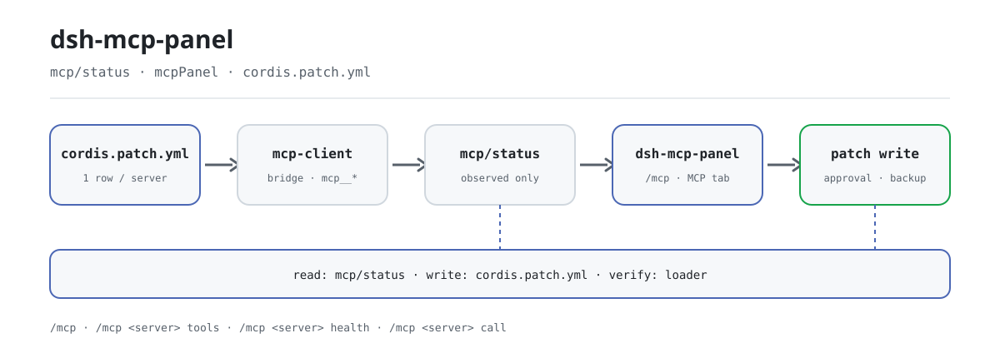

<div align="center">

<picture>
  <source media="(prefers-color-scheme: dark)" srcset="docs/assets/dsh-mcp-panel-flow-dark.svg">
  
</picture>

# dsh-mcp-panel

**Añade, edita, elimina y prueba servidores MCP desde una sola página de ajustes: estado honesto y escrituras reversibles.**

La consola de gestión del cliente MCP oficial de DeepSeek Harness: gestiona servidores en **Ajustes → Plugins → MCP** en lugar de escribir YAML a mano.

[Instalar](#instalación-en-tres-pasos) · [Configuración](#configuración) · [FAQ](#faq) · [简体中文](README.md) · [English](README.en.md) · [Español](README.es.md) · [Português](README.pt.md) · [हिन्दी](README.hi.md)

[](LICENSE)
[](#compatibilidad)
[](https://www.npmjs.com/package/dsh-mcp-panel)
[](https://github.com/PerryLink/dsh-mcp-panel/actions/workflows/ci.yml)
[](#compatibilidad)

[](https://github.com/PerryLink/dsh-mcp-panel/stargazers)
[](https://www.npmjs.com/package/dsh-mcp-panel)
[](https://dshfind.com/plugins/PerryLink/dsh-mcp-panel?ref=badge)
[](https://securityscorecards.dev/viewer/?uri=github.com/PerryLink/dsh-mcp-panel)
[](https://dsh.market/)
[](https://gitee.com/perrylink/dsh-mcp-panel)

```sh
dsh plugin --profile <name> add dsh-mcp-panel
```

</div>

<sub>Repositorio oficial mantenido por PerryLink: <https://github.com/PerryLink/dsh-mcp-panel> (Gitee es un espejo). Plugin de la comunidad, no afiliado a DeepSeek.</sub>

## Qué es

El cliente MCP oficial es el puente: una fila de `@deepseek-ai/dsh-mcp-client` por servidor MCP, que conecta el transporte, sincroniza las herramientas y registra los nombres `mcp__<servidor>__<herramienta>`. `dsh-mcp-panel` es la consola que va encima: lee los hechos por el seam `mcp/status`, el registro de herramientas y el loader, renderiza las operaciones de alta/edición/borrado como fragmentos de `cordis.patch.yml`, y escribe solo parches de solo-anexar, con aprobación, copia de seguridad y re-verificación contra el estado reaplicado por el loader. Transporte, OAuth y protocolo permanecen intactos.

El panel es una vista de runtime de solo lectura: por servidor, transporte, destino, número de herramientas, estado de conexión, último error y reconexiones, más diagnósticos de salud, navegador de Resources y banco de pruebas de herramientas. La única diferencia con un `cordis.yml` escrito a mano es que la edición de YAML propensa a errores se convierte en formularios, vistas previas y aplicación segura.

## Instalación en tres pasos

1. **Instala** (elige un canal):

   ```sh
   # canal git (último main; equivalente a git+https://github.com/PerryLink/dsh-mcp-panel.git)
   dsh plugin --profile web add github:PerryLink/dsh-mcp-panel
   # canal npm (versiones publicadas)
   dsh plugin --profile web add dsh-mcp-panel
   # canal tarball: pnpm pack en este repo y luego
   dsh plugin --profile web add ./dsh-mcp-panel-<version>.tgz
   ```

   En el canal git, el script `prepare` construye solo con dependencias de producción (`typescript` y `tsdown` son `dependencies` a propósito).

2. **Reinicia y confirma que la fila del perfil está montada**:

   ```sh
   dsh --profile web --dump-config | grep -A3 'id: mcp-panel'
   ```

   Los valores por defecto ya sirven; `cordis.patch.yml` documenta cada clave inline y la tabla de configuración de abajo lista todas las claves.

3. **Abre el panel o ejecuta un comando**:

   Abre **Ajustes → Plugins → MCP**, o ejecuta:

   ```text
   /mcp
   /mcp everything tools
   /mcp everything health
   /mcp everything call echo '{"message": "hi"}'
   ```

**Desinstalar**: elimina la fila `mcp-panel` de `cordis.patch.yml` (la superficie web la recarga en caliente), borra el paquete del `node_modules` del perfil y verifica con `dsh web --dump-config` que no quede ninguna fila `mcp-panel`.

<details>
<summary>Instalar desde el mercado de DSH Desktop</summary>

Todos los plugins de PerryLink pueden explorarse en el mercado integrado de DSH Desktop: **Market → Sources → Add source → pegar** `https://perrylink-dsh-catalog.perrylink.workers.dev/catalog-source.json` **→ seleccionarlo**. La instalación sigue pasando por la verificación de identidad npm del mercado y tu confirmación.

</details>

## Capacidades clave

`dsh-mcp-panel` es la capa de experiencia sobre el cliente MCP oficial: una vista de runtime de solo lectura más escrituras de perfil seguras y reversibles.

- **Comando `/mcp`** — una fila por servidor: transporte, destino, número de herramientas, estado de conexión (desde el seam upstream; `unknown` cuando no hay observación), último error, reconexiones — legible por el modelo, reconstruible del log de sesión, cinco idiomas de salida.
- **`/mcp <servidor> tools`** — nombres y descripciones de las herramientas `mcp__*` visibles para el modelo.
- **`/mcp <servidor> health`** — sugerencias de autorreparación derivadas (ENOENT → dependencia faltante, ECONNREFUSED, timeouts, 401/403/404, DNS, rate limit, reconexión agotada…); código de salida / stderr etiquetados honestamente como *pendiente de soporte upstream*.
- **`/mcp <servidor> disable` / `enable`** — apaga o vuelve a encender una fila de servidor sin editar el patch de perfil a mano.
- **`/mcp <servidor> probe`** — una sonda de conectividad Streamable HTTP para ese servidor (trabajo en segundo plano).
- **`/mcp <servidor> call <tool> [json]`** — llamada de prueba por el **pipeline oficial de herramientas** (`ctx.tools.execute()`); política de permisos pre-ejecución, aprobación, guards y post-ejecución, todo en vigor.
- **Ajustes → Plugins → MCP** — tarjetas de estado con insignias, diagnósticos y sondas, más el CRUD de servidores y el banco de pruebas de herramientas.
- **CRUD de servidores** — formularios de alta/edición/borrado → `insert` para alta y anulaciones dirigidas por id (`- id:` + `name:` + `disabled:`/`config:`) para edición/borrado → copia al portapapeles o escritura con aprobación, copias de seguridad automáticas y re-verificación contra el loader.
- **Navegación de Resources** — listado de recursos, listado de plantillas y lecturas de URI de solo lectura mediante las herramientas oficiales `list_mcp_resources` / `list_mcp_resource_templates` / `read_mcp_resource` (puenteadas por el servicio `@deepseek-ai/dsh-mcp-resources`); los resultados se muestran solo en la pestaña, nunca en el contexto del modelo.
- **Directorio recomendado** — un catálogo comunitario integrado de servidores MCP (filesystem, git, github, fetch, playwright…); `catalogEntries` añade o sustituye entradas, y `catalogToConfigInput` convierte una en un alta de un clic.
- **Importación/exportación de configuración** — `exportConfigs()` serializa las filas de servidores a un documento JSON versionado (una fila `!!js` se exporta como `null` con un motivo), e `importPreview()` vuelve a parsear una exportación en fragmentos de parche `add` por servidor para su revisión.
- **Banco de pruebas de herramientas** — servidor → herramienta `mcp__*` → argumentos JSON → resultado JSON canónico + contenido renderizado; limitado por `trialMaxResultChars`; solo panel, nunca contexto del modelo.

### Superficie de comandos y herramientas

| Superficie | Tipo | Notas |
|---|---|---|
| `/mcp` | command | Fila de estado por servidor; legible por el modelo y reconstruible del log |
| `/mcp <servidor> tools` | command | Nombres y descripciones de herramientas `mcp__*` visibles para el modelo |
| `/mcp <servidor> health` | command | Sugerencias de autorreparación derivadas de texto de error saneado |
| `/mcp <servidor> disable` / `enable` | command | Alterna una fila de servidor en el patch de perfil |
| `/mcp <servidor> probe` | command | Una sonda de conectividad Streamable HTTP (trabajo en segundo plano) |
| `/mcp <servidor> call <tool> [json]` | command | Llamada de prueba por el pipeline oficial de herramientas |
| `mcp_probe` | tool | Sonda de conectividad Streamable HTTP opcional (trabajo en segundo plano) |
| Ajustes → Plugins → MCP | slot de UI | Tarjetas de estado, CRUD de servidores y banco de pruebas |
| `mcpPanel` Typert Remote | service | Canal de snapshot de solo lectura (host → client) |

### Ejemplos

Estos son los puntos de entrada reales del plugin; instala una vez y llama a uno.

**Ejemplo detallado** — comando `/mcp github tools`, salida:

```text
Tools of "github" (1, model-visible public names):
- mcp__github__create_issue — Create a new issue in a GitHub repository
```

*Observed from `plugins/dsh-mcp-panel/tests/command.spec.ts:99-110; renderer at src/command.ts:352-360`*

**Rama de fallo** — entrada:

```text
/mcp nope tools
```

Salida:

```text
Unknown MCP server "nope" (configured: github)
```

*Observed from `plugins/dsh-mcp-panel/src/command.ts:104-105; plugins/dsh-mcp-panel/tests/command.spec.ts:152-157`*

**Ejemplos breves**: `/mcp <servidor> tools` · `/mcp <servidor> health`

## Arquitectura: el cliente oficial = puente, este plugin = consola

[`@deepseek-ai/dsh-mcp-client`](https://github.com/deepseek-ai/deepseek-harness/tree/master/packages/mcp/mcp-client) es el **único puente**: una instancia por servidor MCP, configurada como fila escrita a mano en `cordis.yml`, que conecta el transporte, sincroniza herramientas y registra los nombres `mcp__<servidor>__<herramienta>`. Este plugin nunca lo sustituye: es la **capa de experiencia** encima:

```text
                    ┌────────────────────────────────────────────┐
 profile            │  cordis.yml / cordis.patch.yml             │
 composition        │   - id: mcp-github                          │
 (one row per       │     name: '@deepseek-ai/dsh-mcp-client'     │
  server, hand-     │     config: { serverName, transport, … }    │
  written)          │   - id: mcp-panel                           │
                    │     name: dsh-mcp-panel   ◄── this plugin   │
                    └───────────────┬────────────────────────────┘
                                    │
        ┌───────────────────────────┴───────────────────────────┐
        │                                                        │
   ┌────▼──────────────┐        ┌───────────────────────────┐    │
   │ @deepseek-ai/dsh- │        │ dsh-mcp-panel (console)   │    │
   │ mcp-client        │        │                           │    │
   │ • transport       │        │ • /mcp command            │    │
   │ • tool sync       │        │ • Settings → Plugins →    │    │
   │ • mcp__* tools    │◄──────►│   MCP tab: CRUD, trial    │    │
   │ • mcp/status seam │ status │ • health diagnostics      │    │
   └───────────────────┘        │ • probes, capabilities    │    │
                                └───────────────────────────┘    │
```

La consola **lee** el cliente por su seam de observabilidad `mcp/status` (evento + servicio de consulta `mcpStatus`; aún no publicado upstream, detectado por características), el registro de herramientas y el loader; **escribe** solo en la capa de parches del perfil — solo-anexar, con aprobación y siempre con copia de seguridad. Transporte, OAuth y protocolo permanecen intactos.

### Consola vs. cordis.yml escrito a mano

| | cordis.yml a mano | Consola dsh-mcp-panel |
|---|---|---|
| Añadir servidor | Editar YAML, cuidar indentación/comillas | Formulario → fragmento de parche → **copiar** o **escribir** (aprobación + copia de seguridad) |
| Editar servidor | Editar YAML, reiniciar/recarga en caliente | Formulario precargado de la fila en vivo; los secretos sin cambios conservan su valor en el host |
| Eliminar servidor | Borrar la fila | Anulación `- id:` + `disabled: true` (el vocabulario de parches no tiene remove) — re-habilitable |
| Ver estado | Leer logs | Insignias + reconexiones + último error, en vivo desde `mcp/status` |
| Probar herramienta | Pedir al modelo que la llame | Banco de pruebas → pipeline oficial `ctx.tools.execute()` (permisos y aprobación siguen vigentes) |
| Diagnosticar fallos | grep en logs | `/mcp <servidor> health` con sugerencias derivadas |
| Errores | Revertir a mano | Cada escritura es solo-anexar y deja una copia con marca de tiempo |

La salida de la consola ES el vocabulario de `cordis.patch.yml`: las mismas líneas que escribirías a mano, generadas, previsualizadas y aplicadas de forma segura.

## Configuración

Todos los ajustes son campos Schemastery `Config` (modificables desde cordis.yml). Una anulación dirigida por id reemplaza la fila entera: reenumera todas las claves que necesites. `cordis.patch.yml` documenta cada clave inline.

Claves más usadas:

| Clave | Por defecto | Significado |
|---|---|---|
| `probeEnabled` | `true` | Registra la herramienta de trabajo en segundo plano `mcp_probe` (resultados solo en el panel) |
| `probeTimeoutMs` | `10000` | Timeout por sonda en ms |
| `outputLanguage` | `en` | Idioma de salida de `/mcp`: `en \| zh \| es \| pt \| hi` |
| `writeEnabled` | `true` | Interruptor maestro: `false` rechaza toda escritura de perfil (la copia sigue funcionando) |
| `writeVerifyEnabled` | `true` | Re-verifica cada escritura contra el estado reaplicado por el loader antes de reportar éxito |
| `backupCount` | `5` | Copias de `cordis.patch.yml` conservadas por escritura |

<details>
<summary>Tabla de configuración completa (15 claves)</summary>

| Clave | Por defecto | Significado |
|---|---|---|
| `probeEnabled` | `true` | Registra la herramienta de trabajo en segundo plano `mcp_probe` (resultados solo en el panel) |
| `probeTimeoutMs` | `10000` | Timeout por sonda en ms |
| `maxProbes` | `10` | Registros de sonda mostrados en el panel |
| `refreshIntervalMs` | `0` | Refresco sugerido del panel en ms; `0` = bajo demanda |
| `outputLanguage` | `en` | Idioma de salida de `/mcp`: `en \| zh \| es \| pt \| hi` |
| `passiveProbeEnabled` | `false` | Sondea periódicamente servidores streamable-http |
| `passiveProbeIntervalMs` | `60000` | Intervalo de sonda pasiva en ms |
| `trialEnabled` | `true` | Banco de pruebas de herramientas (pestaña de ajustes + `/mcp call`) |
| `trialTimeoutMs` | `120000` | Plazo del lado del panel por llamada de prueba en ms |
| `trialMaxResultChars` | `60000` | Límite del payload de resultado de prueba en caracteres |
| `writeEnabled` | `true` | Interruptor maestro: `false` rechaza toda escritura de perfil (la copia sigue funcionando) |
| `writeVerifyEnabled` | `true` | Re-verifica cada escritura contra el estado reaplicado por el loader antes de reportar éxito |
| `writeVerifyTimeoutMs` | `3000` | Presupuesto de sondeo para la verificación de escritura en ms |
| `backupCount` | `5` | Copias de `cordis.patch.yml` conservadas por escritura |
| `catalogEntries` | `[]` | Superposición de usuario del directorio recomendado: las entradas se añaden y una con el mismo `id` sustituye a la integrada |

</details>

Ejemplo de anulación en el patch de tu perfil:

```yaml
- insert:
    - id: mcp-panel
      name: dsh-mcp-panel
      config:
        probeEnabled: false
        outputLanguage: zh
        writeVerifyTimeoutMs: 5000
        backupCount: 10
```

## FAQ

<details>
<summary>¿El estado de conexión es en vivo? ¿Qué se muestra cuando no hay observación?</summary>

El estado viene del seam `mcp/status` del cliente oficial (aún no publicado upstream; detectado por características). Los campos de conexión sin observación upstream leen `unknown` / `—` con `statusSource: 'derived'`; los códigos de salida y las colas de stderr se etiquetan *pendiente de soporte upstream* hasta que el cliente los exponga. La consola nunca falsifica un estado de conexión: los campos no observables leen `unknown` / `-1` / `—`.

</details>

<details>
<summary>¿La consola reescribe mi cordis.patch.yml? ¿Qué pasa si una escritura sale mal?</summary>

Nunca reescribe el fichero. Las escrituras son fragmentos generados de solo-anexar, con aprobación, conservando las `backupCount` copias más recientes, y cada escritura se re-verifica contra el estado reaplicado por el loader antes de reportar éxito. Si el loader no la aplicó (por ejemplo, una fila insertada por `$DSH_HOME/cordis.patch.yml`, que un parche de capa de perfil no alcanza), la consola reporta el fallo con honestidad. `writeEnabled: false` rechaza toda escritura y los fragmentos siguen siendo copiables.

</details>

<details>
<summary>¿El contenido del panel llega al contexto del modelo? ¿Pueden filtrarse secretos o headers?</summary>

No. El contenido del panel (tarjetas de estado, CRUD, banco de pruebas, navegador de Resources) se muestra solo en la página de ajustes y nunca entra en el contexto del modelo; solo la salida de `/mcp` es legible por el modelo y reconstruible del log de sesión. Las credenciales en query de URL, contraseñas de userinfo, valores de header, bearer tokens y JWT se redactan antes de renderizar; los `headers` configurados nunca entran en ningún snapshot, y los **valores** de env/header nunca salen del host (el editor solo ve claves).

</details>

<details>
<summary>¿Qué relación tiene con el mcp-client oficial? ¿Lo sustituye o interfiere?</summary>

No lo sustituye. `@deepseek-ai/dsh-mcp-client` es el único puente: una instancia por servidor MCP, una fila de `cordis.yml` / `cordis.patch.yml`, dueño del transporte, OAuth y protocolo. Este plugin solo lee el seam de estado, el registro de herramientas y el loader; sus escrituras caen solo en la capa de parches del perfil, no registra secciones de prompt, y transporte, OAuth y protocolo permanecen intactos.

</details>

## Límites de seguridad

- **El puente sigue siendo el puente.** Sin cambios de transporte, OAuth ni protocolo; una fila mcp-client por servidor, exactamente como a mano.
- **Sin estados falsos.** Los campos de conexión sin observación upstream leen `unknown` / `—` con `statusSource: 'derived'`; los códigos de salida y las colas de stderr nunca se inventan.
- **Escrituras de solo-anexar, con aprobación y copia de seguridad.** La consola nunca reescribe `cordis.patch.yml`: añade operaciones generadas, conserva las `backupCount` copias más recientes y re-verifica cada escritura contra el estado reaplicado por el loader antes de reportar éxito (un parche omitido nunca se lee como éxito).
- **Sin inyección de prompt.** El panel no registra **ninguna sección de prompt**; su único texto visible para el modelo son las dos descripciones de herramienta/comando.

## Permisos y datos

- **Permisos**: el manifest `dshWorkshop` declara `network:outbound` y `native-code:none`.
- **Datos**: el panel es de solo lectura; solo escribe fragmentos de `cordis.patch.yml` de solo-anexar (con aprobación, copia primero). Las credenciales en query de URL, contraseñas de userinfo, valores de header, bearer tokens y JWT se redactan antes de renderizar; los `headers` configurados nunca entran en ningún snapshot, y los **valores** de env/header nunca salen del host (el editor solo ve claves).

## Limitaciones conocidas

- **Plantillas de prompt y suscripciones a recursos** pendientes de soporte upstream: el cliente oficial puentea herramientas y recursos, pero no prompts ni suscripciones.
- **Códigos de salida / colas de stderr** se etiquetan *pendiente de soporte upstream* hasta que el cliente los exponga.
- **Panel de solo lectura** — la consola nunca falsifica un estado de conexión; los campos no observables leen `unknown` / `-1` / `—`.
- **Las escrituras se verifican, no se garantizan** — la consola re-verifica cada escritura contra el estado reaplicado por el loader y falla con honestidad cuando el loader no la aplicó (p. ej. una fila insertada por `$DSH_HOME/cordis.patch.yml`, que un parche de capa de perfil no alcanza).

## Compatibilidad

| Superficie | Estado |
|---|---|
| Harness | DeepSeek Harness `dsh-v0.2.1-rc.2` (verificado 2026-10-18): `engines.dsh >=0.2.1-0 <0.3.0`; las rutas de compatibilidad P0 tienen pruebas de regresión. |
| Node | `^22.19.0 \|\| >=24.9.0` |
| Plataformas | Web GUI (doble cara: host + navegador) |
| Modelo | Cualquiera (el panel es de solo lectura; solo la salida de `/mcp` es legible por el modelo) |

## Resources y Prompts

Resources SÍ está puenteado upstream: el bundle base monta `@deepseek-ai/dsh-mcp-resources`, el cliente oficial registra el proveedor de recursos de cada conexión en `ctx.mcpResources`, y ese paquete posee las tres herramientas compartidas (`list_mcp_resources`, `list_mcp_resource_templates`, `read_mcp_resource`). La consola detecta por características el servicio y las herramientas registradas, y ofrece un navegador de Resources de solo lectura (lista / plantillas / lectura de URI) en cada tarjeta de servidor: cada llamada pasa por el pipeline OFICIAL de herramientas y los resultados nunca entran en el contexto del modelo.

Las **plantillas de prompt** MCP y las **suscripciones a recursos** siguen diferidas upstream; el tablero de capacidades marca Prompts como **pendiente de soporte upstream**.

## Ecosistema y calidad

- [Espejo de Gitee](https://gitee.com/perrylink/dsh-mcp-panel) (espejo sincronizado; GitHub es el canónico)
- [Página del plugin en dshfind](https://dshfind.com/plugins/PerryLink/dsh-mcp-panel) (instalaciones y ranking)
- [Informe de OpenSSF Scorecard](https://securityscorecards.dev/viewer/?uri=github.com/PerryLink/dsh-mcp-panel) (impulsado por [.github/workflows/scorecard.yml](.github/workflows/scorecard.yml))
- [Informe de verificación de dsh-plugin-doctor](https://github.com/PerryLink/dsh-plugin-doctor#verified-徽章) (impulsado por [.github/workflows/plugin-doctor.yml](.github/workflows/plugin-doctor.yml))
- [DSH Market](https://dsh.market/) (listado)
- **Canal de la tienda 1024**: `npm i -g dsh1024` una vez y luego `dsh1024 plugin --profile web add dsh-mcp-panel` (cuenta para el ranking de instalaciones de [deepseek1024.com](https://deepseek1024.com))
- [Base de conocimiento del ecosistema](https://perrylink.github.io/dsh-plugin-guide/) — datos medidos, no marketing: guía de desarrollo de plugins · datos de selección · criterios de mantenimiento

## Desarrollo

```sh
pnpm run typecheck && pnpm run typecheck:ci && pnpm test && pnpm run build && pnpm run verify:self-contained && pnpm run verify:artifacts && pnpm pack
pnpm run check:readmes
node scripts/verify-headless.mjs
```

`pnpm run typecheck` resuelve las caras de tipos frescas del checkout local del harness mediante los `paths` de tsconfig, mientras que `typecheck:ci` resuelve las caras publicadas en npm `0.1.7-rc.2`; ambas deben quedar en verde. `scripts/verify-headless.mjs` arranca el perfil web real e imprime la salida exacta de `/mcp`. Publicación: `node scripts/release.mjs <x.y.z>` ejecuta la puerta completa, hace commit y etiqueta `v<x.y.z>` en local (nunca empuja).

Las imágenes del README se generan programáticamente con [`scripts/gen-readme-assets.py`](scripts/gen-readme-assets.py) (Python + Pillow), que escribe `docs/assets/dsh-mcp-panel-flow-{light,dark}.svg` y se puede reejecutar sin riesgo.

Topics: `dsh`, `dsh-plugin`, `deepseek-harness`, `deepseek`, `cordis`, `mcp`, `mcp-client`, `observability`, `panel`

## Familia y agradecimientos

Este proyecto forma parte de la familia de plugins de DeepSeek Harness de [PerryLink](https://github.com/PerryLink) (todos Apache-2.0). Si te resulta útil, **una estrella ayuda a que la siguiente persona lo encuentre** — no hay nada bloqueado tras ella.

- [@PerryLink](https://github.com/PerryLink) — creador y mantenedor.
- [@xiaoyuyu6420](https://github.com/xiaoyuyu6420) — diagnosticó las devDependencies del cliente que faltaban detrás de los fallos de build en checkout limpio (PR #5).
- [@feiler0](https://github.com/feiler0) — contribuyó la sonda de servidores MCP stdio (un handshake MCP initialize por stdin/stdout) (PR #7, fusionado como PR #15).

<details>
<summary>Expandir todos los plugins</summary>

| Plugin | Estado |
|---|---|
| **[dsh-aqua-input-check](https://github.com/PerryLink/dsh-aqua-input-check)** |  |
| **[dsh-archive-check](https://github.com/PerryLink/dsh-archive-check)** |  |
| **[dsh-auto-review](https://github.com/PerryLink/dsh-auto-review)** |  |
| **[dsh-autotier](https://github.com/PerryLink/dsh-autotier)** | 🧊 CONGELADO — ver el README del repo |
| **[dsh-bid-ca-precheck](https://github.com/PerryLink/dsh-bid-ca-precheck)** |  |
| **[dsh-bid-qual-check](https://github.com/PerryLink/dsh-bid-qual-check)** |  |
| **[dsh-cert-mcp](https://github.com/PerryLink/dsh-cert-mcp)** | 🧊 CONGELADO — ver el README del repo |
| **[dsh-checkpoint-rewind](https://github.com/PerryLink/dsh-checkpoint-rewind)** |  |
| **[dsh-click](https://github.com/PerryLink/dsh-click)** |  |
| **[dsh-composer-history](https://github.com/PerryLink/dsh-composer-history)** |  |
| **[dsh-contract-stance](https://github.com/PerryLink/dsh-contract-stance)** |  |
| **[dsh-customs-doc-check](https://github.com/PerryLink/dsh-customs-doc-check)** |  |
| **[dsh-data-quality](https://github.com/PerryLink/dsh-data-quality)** | 🧊 CONGELADO — ver el README del repo |
| **[dsh-demurrage-ledger](https://github.com/PerryLink/dsh-demurrage-ledger)** |  |
| **[dsh-doublecheck](https://github.com/PerryLink/dsh-doublecheck)** |  |
| **[dsh-drill-script-check](https://github.com/PerryLink/dsh-drill-script-check)** |  |
| **[dsh-eia-guide-check](https://github.com/PerryLink/dsh-eia-guide-check)** |  |
| **[dsh-emergency-plan](https://github.com/PerryLink/dsh-emergency-plan)** |  |
| **[dsh-essay-rubric-check](https://github.com/PerryLink/dsh-essay-rubric-check)** |  |
| **[dsh-evidence-check](https://github.com/PerryLink/dsh-evidence-check)** |  |
| **[dsh-export-ctl-check](https://github.com/PerryLink/dsh-export-ctl-check)** |  |
| **[dsh-fast](https://github.com/PerryLink/dsh-fast)** |  |
| **[dsh-fmea-table-check](https://github.com/PerryLink/dsh-fmea-table-check)** |  |
| **[dsh-forecast-penalty](https://github.com/PerryLink/dsh-forecast-penalty)** |  |
| **[dsh-fund-research](https://github.com/PerryLink/dsh-fund-research)** |  |
| **[dsh-github](https://github.com/PerryLink/dsh-github)** |  |
| **[dsh-gongwen-flow-check](https://github.com/PerryLink/dsh-gongwen-flow-check)** |  |
| **[dsh-gongwen-word-check](https://github.com/PerryLink/dsh-gongwen-word-check)** |  |
| **[dsh-guard-plan-qc](https://github.com/PerryLink/dsh-guard-plan-qc)** |  |
| **[dsh-hazchem-check](https://github.com/PerryLink/dsh-hazchem-check)** |  |
| **[dsh-hazplan-check](https://github.com/PerryLink/dsh-hazplan-check)** |  |
| **[dsh-hidden-risk-map](https://github.com/PerryLink/dsh-hidden-risk-map)** |  |
| **[dsh-hs-classify](https://github.com/PerryLink/dsh-hs-classify)** |  |
| **[dsh-icd-rule-check](https://github.com/PerryLink/dsh-icd-rule-check)** |  |
| **[dsh-industry-research](https://github.com/PerryLink/dsh-industry-research)** |  |
| **[dsh-lawcite-adapter](https://github.com/PerryLink/dsh-lawcite-adapter)** |  |
| **[dsh-laya](https://github.com/PerryLink/dsh-laya)** |  |
| **[dsh-lc-doc-check](https://github.com/PerryLink/dsh-lc-doc-check)** |  |
| **[dsh-learning-gap-check](https://github.com/PerryLink/dsh-learning-gap-check)** |  |
| **[dsh-library](https://github.com/PerryLink/dsh-library)** |  |
| **[dsh-local-ai](https://github.com/PerryLink/dsh-local-ai)** |  |
| **[dsh-lsp-actions](https://github.com/PerryLink/dsh-lsp-actions)** |  |
| **[dsh-mask](https://github.com/PerryLink/dsh-mask)** |  |
| **[dsh-mcp-panel](https://github.com/PerryLink/dsh-mcp-panel)** |  |
| **[dsh-medrec-qc](https://github.com/PerryLink/dsh-medrec-qc)** |  |
| **[dsh-memento](https://github.com/PerryLink/dsh-memento)** | 🧊 CONGELADO — ver el README del repo |
| **[dsh-nsfc-form-check](https://github.com/PerryLink/dsh-nsfc-form-check)** |  |
| **[dsh-nurse-record-check](https://github.com/PerryLink/dsh-nurse-record-check)** |  |
| **[dsh-observe](https://github.com/PerryLink/dsh-observe)** |  |
| **[dsh-origin-rvc-check](https://github.com/PerryLink/dsh-origin-rvc-check)** |  |
| **[dsh-ota-review-check](https://github.com/PerryLink/dsh-ota-review-check)** |  |
| **[dsh-output-styles](https://github.com/PerryLink/dsh-output-styles)** |  |
| **[dsh-paper-doc-adapter](https://github.com/PerryLink/dsh-paper-doc-adapter)** |  |
| **[dsh-permission-rules](https://github.com/PerryLink/dsh-permission-rules)** |  |
| **[dsh-permit-report-check](https://github.com/PerryLink/dsh-permit-report-check)** |  |
| **[dsh-pipeline-check](https://github.com/PerryLink/dsh-pipeline-check)** |  |
| **[dsh-pleading-draft](https://github.com/PerryLink/dsh-pleading-draft)** |  |
| **[dsh-plugin-doctor](https://github.com/PerryLink/dsh-plugin-doctor)** | 🚫 RETIRADO (repo archivado) |
| **[dsh-plugin-guide](https://github.com/PerryLink/dsh-plugin-guide)** |  |
| **[dsh-plugin-kit](https://github.com/PerryLink/dsh-plugin-kit)** | 🚫 RETIRADO (repo archivado) |
| **[dsh-plugin-upgrade](https://github.com/PerryLink/dsh-plugin-upgrade)** | 🚫 RETIRADO (repo archivado) |
| **[dsh-policy-brief-draft](https://github.com/PerryLink/dsh-policy-brief-draft)** |  |
| **[dsh-power-loss-split](https://github.com/PerryLink/dsh-power-loss-split)** |  |
| **[dsh-power-ticket-check](https://github.com/PerryLink/dsh-power-ticket-check)** |  |
| **[dsh-ppap-check](https://github.com/PerryLink/dsh-ppap-check)** |  |
| **[dsh-protest-deadline](https://github.com/PerryLink/dsh-protest-deadline)** |  |
| **[dsh-railway-window](https://github.com/PerryLink/dsh-railway-window)** |  |
| **[dsh-repair-order-qc](https://github.com/PerryLink/dsh-repair-order-qc)** |  |
| **[dsh-research-report](https://github.com/PerryLink/dsh-research-report)** |  |
| **[dsh-review-reply-check](https://github.com/PerryLink/dsh-review-reply-check)** |  |
| **[dsh-rulefile-check](https://github.com/PerryLink/dsh-rulefile-check)** |  |
| **[dsh-safety-brief-check](https://github.com/PerryLink/dsh-safety-brief-check)** |  |
| **[dsh-score](https://github.com/PerryLink/dsh-score)** | 🧊 CONGELADO — ver el README del repo |
| **[dsh-session-sync](https://github.com/PerryLink/dsh-session-sync)** |  |
| **[dsh-site-log-check](https://github.com/PerryLink/dsh-site-log-check)** |  |
| **[dsh-skill-pack-security](https://github.com/PerryLink/dsh-skill-pack-security)** |  |
| **[dsh-soe-decision-check](https://github.com/PerryLink/dsh-soe-decision-check)** |  |
| **[dsh-soilwater-check](https://github.com/PerryLink/dsh-soilwater-check)** |  |
| **[dsh-sop-sync-check](https://github.com/PerryLink/dsh-sop-sync-check)** |  |
| **[dsh-spc-gbt-adapter](https://github.com/PerryLink/dsh-spc-gbt-adapter)** |  |
| **[dsh-talk](https://github.com/PerryLink/dsh-talk)** |  |
| **[dsh-tender-extract](https://github.com/PerryLink/dsh-tender-extract)** |  |
| **[dsh-tender-matrix](https://github.com/PerryLink/dsh-tender-matrix)** |  |
| **[dsh-test-drive](https://github.com/PerryLink/dsh-test-drive)** |  |
| **[dsh-ticktick](https://github.com/PerryLink/dsh-ticktick)** | 🚫 RETIRADO (repo archivado) |
| **[dsh-translate](https://github.com/PerryLink/dsh-translate)** |  |
| **[dsh-warranty-calc](https://github.com/PerryLink/dsh-warranty-calc)** |  |
| **[dsh-budget](https://github.com/PerryLink/dsh-budget)** | 🧊 CONGELADO — ver el README del repo |
| **[dsh-claude-move](https://github.com/PerryLink/dsh-claude-move)** | 🧊 CONGELADO — ver el README del repo |
| **[dsh-defend](https://github.com/PerryLink/dsh-defend)** | 🧊 CONGELADO — ver el README del repo |
| **[dsh-draw](https://github.com/PerryLink/dsh-draw)** | 🧊 CONGELADO — ver el README del repo |
| **[dsh-reach](https://github.com/PerryLink/dsh-reach)** | 🧊 CONGELADO — ver el README del repo |
| **[dsh-background-agents](https://github.com/PerryLink/dsh-background-agents)** | 🚫 RETIRADO (repo archivado) |
| **[dsh-session-pin](https://github.com/PerryLink/dsh-session-pin)** | 🚫 RETIRADO (repo archivado) |
| **[dsh-team-rooms](https://github.com/PerryLink/dsh-team-rooms)** | 🚫 RETIRADO (repo archivado) |

</details>

## Licencia

[LICENSE](LICENSE) (Apache License 2.0) © 2026 dsh-mcp-panel contributors

<p align="center"><sub>Apache-2.0 · Plugin de la comunidad, no afiliado a DeepSeek.</sub></p>
