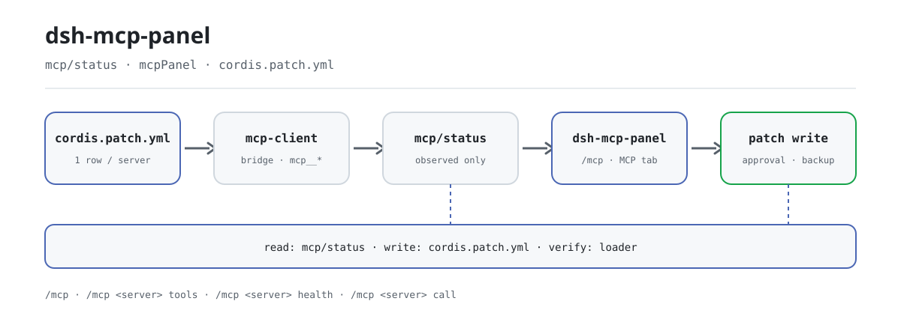

<div align="center">

<picture>
  <source media="(prefers-color-scheme: dark)" srcset="docs/assets/dsh-mcp-panel-flow-dark.svg">
  
</picture>

# dsh-mcp-panel

**MCP सर्वर जोड़ें, बदलें, हटाएँ और टूल आज़माएँ — एक ही सेटिंग्स पेज से; ईमानदार स्थिति, वापस लेने योग्य लिखावट।**

आधिकारिक DeepSeek Harness MCP क्लाइंट का प्रबंधन कंसोल: हाथ से YAML लिखने के बजाय **सेटिंग्स → प्लगइन्स → MCP** में सर्वर प्रबंधित करें।

[इंस्टॉल](#तीन-चरणों-में-शुरुआत) · [कॉन्फ़िगरेशन](#कॉन्फ़िगरेशन) · [FAQ](#faq) · [简体中文](README.md) · [English](README.en.md) · [Español](README.es.md) · [Português](README.pt.md) · [हिन्दी](README.hi.md)

[](LICENSE)
[](#संगतता)
[](https://www.npmjs.com/package/dsh-mcp-panel)
[](https://github.com/PerryLink/dsh-mcp-panel/actions/workflows/ci.yml)
[](#संगतता)

[](https://github.com/PerryLink/dsh-mcp-panel/stargazers)
[](https://www.npmjs.com/package/dsh-mcp-panel)
[](https://dshfind.com/plugins/PerryLink/dsh-mcp-panel?ref=badge)
[](https://securityscorecards.dev/viewer/?uri=github.com/PerryLink/dsh-mcp-panel)
[](https://dsh.market/)
[](https://gitee.com/perrylink/dsh-mcp-panel)

```sh
dsh plugin --profile <name> add dsh-mcp-panel
```

</div>

<sub>PerryLink द्वारा अनुरक्षित आधिकारिक रेपो: <https://github.com/PerryLink/dsh-mcp-panel> (Gitee एक मिरर है)। सामुदायिक प्लगइन, DeepSeek से असंबद्ध।</sub>

## यह क्या है

आधिकारिक MCP क्लाइंट ब्रिज है: प्रति MCP सर्वर एक `@deepseek-ai/dsh-mcp-client` पंक्ति, जो ट्रांसपोर्ट जोड़ती है, टूल सिंक करती है और `mcp__<server>__<tool>` नाम रजिस्टर करती है। `dsh-mcp-panel` इसके ऊपर का कंसोल है — यह `mcp/status` seam, टूल रजिस्ट्री और loader से तथ्य पढ़ता है, जोड़ने/बदलने/हटाने की क्रियाओं को `cordis.patch.yml` फ़्रैगमेंट में बदलता है, और केवल जोड़ने वाले, अनुमोदन-आधारित, पहले-बैकअप वाले patch लिखता है जिन्हें loader के पुनः-लागू स्थिति के विरुद्ध सत्यापित किया जाता है। ट्रांसपोर्ट, OAuth और प्रोटोकॉल अछूते रहते हैं।

पैनल केवल-पढ़ने वाला रनटाइम दृश्य है: प्रति सर्वर ट्रांसपोर्ट, लक्ष्य, टूल संख्या, कनेक्शन स्थिति, अंतिम त्रुटि और पुनःकनेक्शन, साथ में स्वास्थ्य निदान, Resources ब्राउज़र और टूल परीक्षण कंसोल। हाथ से लिखे `cordis.yml` से एकमात्र अंतर यह है कि त्रुटि-प्रवण YAML संपादन फ़ॉर्म, पूर्वावलोकन और सुरक्षित अनुप्रयोग बन जाता है।

## तीन चरणों में शुरुआत

1. **इंस्टॉल करें** (एक चैनल चुनें):

   ```sh
   # git चैनल (नवीनतम main; git+https://github.com/PerryLink/dsh-mcp-panel.git के बराबर)
   dsh plugin --profile web add github:PerryLink/dsh-mcp-panel
   # npm चैनल (प्रकाशित संस्करण)
   dsh plugin --profile web add dsh-mcp-panel
   # tarball चैनल: इस रेपो में pnpm pack के बाद
   dsh plugin --profile web add ./dsh-mcp-panel-<version>.tgz
   ```

   git चैनल में `prepare` स्क्रिप्ट केवल उत्पादन निर्भरताओं से बिल्ड करती है (`typescript` और `tsdown` जानबूझकर `dependencies` में हैं)।

2. **रीस्टार्ट करें और पुष्टि करें कि profile पंक्ति माउंट है**:

   ```sh
   dsh --profile web --dump-config | grep -A3 'id: mcp-panel'
   ```

   डिफ़ॉल्ट वैसे ही काम करते हैं; `cordis.patch.yml` हर कुंजी को इनलाइन समझाता है, और नीचे की कॉन्फ़िगरेशन तालिका सभी कुंजियाँ सूचीबद्ध करती है।

3. **पैनल खोलें या कमांड चलाएँ**:

   **सेटिंग्स → प्लगइन्स → MCP** खोलें, या चलाएँ:

   ```text
   /mcp
   /mcp everything tools
   /mcp everything health
   /mcp everything call echo '{"message": "hi"}'
   ```

**अनइंस्टॉल**: `cordis.patch.yml` से `mcp-panel` पंक्ति हटाएँ (web सतह उसे हॉट-रीलोड करती है), profile के `node_modules` से पैकेज हटाएँ, और `dsh web --dump-config` से पुष्टि करें कि कोई `mcp-panel` पंक्ति नहीं बची।

<details>
<summary>DSH Desktop मार्केट से इंस्टॉल करें</summary>

हर PerryLink प्लगइन DSH Desktop के अंतर्निहित मार्केट में सूचीबद्ध है: **Market → Sources → Add source → पेस्ट करें** `https://perrylink-dsh-catalog.perrylink.workers.dev/catalog-source.json` **→ चुनें**। इंस्टॉल अभी भी मार्केट के npm पहचान सत्यापन और आपकी पुष्टि से गुज़रता है।

</details>

## मुख्य क्षमताएँ

`dsh-mcp-panel` आधिकारिक MCP क्लाइंट के ऊपर अनुभव परत है: केवल-पढ़ने वाला रनटाइम दृश्य और सुरक्षित, वापस लेने योग्य profile लेखन।

- **`/mcp` कमांड** — प्रति सर्वर एक पंक्ति: ट्रांसपोर्ट, लक्ष्य, टूल संख्या, कनेक्शन स्थिति (upstream seam से; अवलोकन न होने पर `unknown`), अंतिम त्रुटि, पुनःकनेक्शन — मॉडल-पठनीय, सत्र लॉग से पुनर्निर्माण योग्य, पाँच आउटपुट भाषाएँ।
- **`/mcp <server> tools`** — मॉडल को दिखने वाले `mcp__*` टूल नाम और विवरण।
- **`/mcp <server> health`** — व्युत्पन्न स्व-उपचार सुझाव (ENOENT → अनुपस्थित निर्भरता, ECONNREFUSED, टाइमआउट, 401/403/404, DNS, रेट लिमिट, पुनःकनेक्शन समाप्त…); exit code / stderr पूँछ ईमानदारी से *upstream समर्थन लंबित* अंकित।
- **`/mcp <server> disable` / `enable`** — profile patch हाथ से बदले बिना किसी सर्वर पंक्ति को बंद या फिर चालू करें।
- **`/mcp <server> probe`** — उस सर्वर के लिए एक Streamable HTTP कनेक्टिविटी जाँच (पृष्ठभूमि कार्य)।
- **`/mcp <server> call <tool> [json]`** — **आधिकारिक टूल पाइपलाइन** (`ctx.tools.execute()`) से परीक्षण कॉल; pre-execute अनुमति नीति, अनुमोदन, guard और post-execute सभी लागू रहते हैं।
- **सेटिंग्स → प्लगइन्स → MCP टैब** — बैज, निदान और जाँच वाले स्टेटस कार्ड, साथ में सर्वर CRUD और टूल परीक्षण कंसोल।
- **सर्वर CRUD** — जोड़ें/बदलें/हटाएँ फ़ॉर्म → जोड़ने के लिए `insert`, बदलने/हटाने के लिए id-लक्षित ओवरराइड (`- id:` + `name:` + `disabled:`/`config:`) → क्लिपबोर्ड कॉपी या अनुमोदन-आधारित लेखन, स्वचालित बैकअप और loader के विरुद्ध पुनः-सत्यापन।
- **Resources ब्राउज़** — आधिकारिक `list_mcp_resources` / `list_mcp_resource_templates` / `read_mcp_resource` टूल से केवल-पढ़ने वाली संसाधन सूची, टेम्पलेट सूची और URI पठन (शिप्ड `@deepseek-ai/dsh-mcp-resources` सेवा द्वारा ब्रिज); परिणाम केवल टैब में दिखते हैं, कभी मॉडल संदर्भ में नहीं।
- **अनुशंसित निर्देशिका** — अंतर्निहित सामुदायिक MCP सर्वर कैटलॉग (filesystem, git, github, fetch, playwright…); `catalogEntries` प्रविष्टियाँ जोड़ता/बदलता है, और `catalogToConfigInput` एक प्रविष्टि को एक-क्लिक जोड़ में बदलता है।
- **कॉन्फ़िग आयात/निर्यात** — `exportConfigs()` सर्वर पंक्तियों को संस्करण-युक्त JSON दस्तावेज़ में क्रमबद्ध करता है (`!!js` पंक्ति कारण सहित `null` के रूप में निर्यात होती है), और `importPreview()` निर्यात को समीक्षा के लिए प्रति-सर्वर `add` patch फ़्रैगमेंट में वापस पार्स करता है।
- **टूल परीक्षण कंसोल** — सर्वर → `mcp__*` टूल → JSON आर्ग्युमेंट → कैनोनिकल JSON परिणाम + रेंडर सामग्री; `trialMaxResultChars` से सीमित; केवल पैनल, कभी मॉडल संदर्भ नहीं।

### कमांड और टूल सतह

| सतह | प्रकार | टिप्पणियाँ |
|---|---|---|
| `/mcp` | command | प्रति सर्वर स्टेटस पंक्ति; मॉडल-पठनीय और लॉग से पुनर्निर्माण योग्य |
| `/mcp <server> tools` | command | मॉडल को दिखने वाले `mcp__*` टूल नाम + विवरण |
| `/mcp <server> health` | command | सैनिटाइज़्ड त्रुटि पाठ से व्युत्पन्न स्व-उपचार सुझाव |
| `/mcp <server> disable` / `enable` | command | profile patch में एक सर्वर पंक्ति टॉगल करें |
| `/mcp <server> probe` | command | एक Streamable HTTP कनेक्टिविटी जाँच (पृष्ठभूमि कार्य) |
| `/mcp <server> call <tool> [json]` | command | आधिकारिक टूल पाइपलाइन से परीक्षण कॉल |
| `mcp_probe` | tool | वैकल्पिक Streamable HTTP कनेक्टिविटी जाँच (पृष्ठभूमि कार्य) |
| सेटिंग्स → प्लगइन्स → MCP टैब | UI स्लॉट | स्टेटस कार्ड, सर्वर CRUD और टूल परीक्षण कंसोल |
| `mcpPanel` Typert Remote | service | केवल-पढ़ने वाला स्नैपशॉट चैनल (host → client) |

### उदाहरण

ये प्लगइन के वास्तविक प्रवेश-बिंदु हैं; एक बार इंस्टॉल करें, फिर एक चलाएँ।

**विस्तृत उदाहरण** — कमांड `/mcp github tools`, आउटपुट:

```text
Tools of "github" (1, model-visible public names):
- mcp__github__create_issue — Create a new issue in a GitHub repository
```

*Observed from `plugins/dsh-mcp-panel/tests/command.spec.ts:99-110; renderer at src/command.ts:352-360`*

**विफलता शाखा** — इनपुट:

```text
/mcp nope tools
```

आउटपुट:

```text
Unknown MCP server "nope" (configured: github)
```

*Observed from `plugins/dsh-mcp-panel/src/command.ts:104-105; plugins/dsh-mcp-panel/tests/command.spec.ts:152-157`*

**संक्षिप्त उदाहरण**: `/mcp <server> tools` · `/mcp <server> health`

## आर्किटेक्चर: आधिकारिक क्लाइंट = ब्रिज, यह प्लगइन = कंसोल

[`@deepseek-ai/dsh-mcp-client`](https://github.com/deepseek-ai/deepseek-harness/tree/master/packages/mcp/mcp-client) **एकमात्र ब्रिज** है: प्रति MCP सर्वर एक प्लगइन इंस्टेंस, हाथ से लिखी `cordis.yml` पंक्ति के रूप में कॉन्फ़िगर, जो ट्रांसपोर्ट जोड़ता है, टूल सिंक करता है और `mcp__<server>__<tool>` नाम रजिस्टर करता है। यह प्लगइन उसे कभी नहीं बदलता — यह उसके ऊपर की **अनुभव परत** है:

```text
                    ┌────────────────────────────────────────────┐
 profile            │  cordis.yml / cordis.patch.yml             │
 composition        │   - id: mcp-github                          │
 (one row per       │     name: '@deepseek-ai/dsh-mcp-client'     │
  server, hand-     │     config: { serverName, transport, … }    │
  written)          │   - id: mcp-panel                           │
                    │     name: dsh-mcp-panel   ◄── this plugin   │
                    └───────────────┬────────────────────────────┘
                                    │
        ┌───────────────────────────┴───────────────────────────┐
        │                                                        │
   ┌────▼──────────────┐        ┌───────────────────────────┐    │
   │ @deepseek-ai/dsh- │        │ dsh-mcp-panel (console)   │    │
   │ mcp-client        │        │                           │    │
   │ • transport       │        │ • /mcp command            │    │
   │ • tool sync       │        │ • Settings → Plugins →    │    │
   │ • mcp__* tools    │◄──────►│   MCP tab: CRUD, trial    │    │
   │ • mcp/status seam │ status │ • health diagnostics      │    │
   └───────────────────┘        │ • probes, capabilities    │    │
                                └───────────────────────────┘    │
```

कंसोल क्लाइंट को उसके `mcp/status` ऑब्ज़र्वेबिलिटी seam (इवेंट + `mcpStatus` क्वेरी सेवा; upstream में अभी प्रकाशित नहीं, फ़ीचर-डिटेक्टेड), टूल रजिस्ट्री और loader से **पढ़ता** है; **लिखता** केवल profile की patch परत में है — केवल-जोड़ने वाला, अनुमोदन-आधारित, हमेशा बैकअप सहित। ट्रांसपोर्ट, OAuth और प्रोटोकॉल पूरी तरह अछूते रहते हैं।

### कंसोल बनाम हाथ से लिखा cordis.yml

| | हाथ से लिखा cordis.yml | dsh-mcp-panel कंसोल |
|---|---|---|
| सर्वर जोड़ें | YAML बदलें, इंडेंट/कोट्स का ध्यान रखें | फ़ॉर्म → patch फ़्रैगमेंट → **कॉपी** या **लिखें** (अनुमोदन + स्वचालित बैकअप) |
| सर्वर बदलें | YAML बदलें, रीस्टार्ट/हॉट-रीलोड | फ़ॉर्म लाइव पंक्ति से भरा; बिना बदले सीक्रेट host पर मूल मान रखते हैं |
| सर्वर हटाएँ | पंक्ति मिटाएँ | `- id:` + `disabled: true` ओवरराइड (patch शब्दावली में remove नहीं है) — कभी भी फिर सक्षम करें |
| स्थिति देखें | लॉग पढ़ें | बैज + पुनःकनेक्शन + अंतिम त्रुटि, `mcp/status` seam से लाइव |
| टूल आज़माएँ | मॉडल से कॉल करवाएँ | परीक्षण कंसोल → आधिकारिक `ctx.tools.execute()` पाइपलाइन (अनुमति और अनुमोदन लागू) |
| विफलता जाँचें | लॉग में grep | `/mcp <server> health` व्युत्पन्न स्व-उपचार सुझावों के साथ |
| गलती | हाथ से रिवर्ट | हर लेखन केवल-जोड़ने वाला है और समय-चिह्नित बैकअप छोड़ता है |

कंसोल का आउटपुट ही `cordis.patch.yml` की शब्दावली है — वही पंक्तियाँ जो आप हाथ से लिखते, अब उत्पन्न, पूर्वावलोकित और सुरक्षित रूप से लागू।

## कॉन्फ़िगरेशन

सभी ट्यूनिंग Schemastery `Config` फ़ील्ड हैं (cordis.yml से बदले जा सकते हैं)। id-लक्षित ओवरराइड पूरी पंक्ति बदल देता है — जो कुंजियाँ चाहिए उन सभी को दोहराएँ। `cordis.patch.yml` हर कुंजी को इनलाइन समझाता है।

सर्वाधिक प्रयुक्त कुंजियाँ:

| कुंजी | डिफ़ॉल्ट | अर्थ |
|---|---|---|
| `probeEnabled` | `true` | `mcp_probe` पृष्ठभूमि-कार्य टूल रजिस्टर करें (परिणाम केवल पैनल में) |
| `probeTimeoutMs` | `10000` | प्रति जाँच टाइमआउट (ms) |
| `outputLanguage` | `en` | `/mcp` आउटपुट भाषा: `en \| zh \| es \| pt \| hi` |
| `writeEnabled` | `true` | मास्टर स्विच: `false` हर profile लेखन अस्वीकार करता है (कॉपी अभी भी काम करती है) |
| `writeVerifyEnabled` | `true` | सफलता बताने से पहले हर लेखन को loader के पुनः-लागू स्थिति के विरुद्ध पुनः-सत्यापित करें |
| `backupCount` | `5` | प्रति लेखन रखे जाने वाले `cordis.patch.yml` बैकअप |

<details>
<summary>पूर्ण कॉन्फ़िगरेशन तालिका (15 कुंजियाँ)</summary>

| कुंजी | डिफ़ॉल्ट | अर्थ |
|---|---|---|
| `probeEnabled` | `true` | `mcp_probe` पृष्ठभूमि-कार्य टूल रजिस्टर करें (परिणाम केवल पैनल में) |
| `probeTimeoutMs` | `10000` | प्रति जाँच टाइमआउट (ms) |
| `maxProbes` | `10` | पैनल में दिखने वाले जाँच रिकॉर्ड |
| `refreshIntervalMs` | `0` | सुझाया गया पैनल रीफ़्रेश (ms); `0` = माँग पर |
| `outputLanguage` | `en` | `/mcp` आउटपुट भाषा: `en \| zh \| es \| pt \| hi` |
| `passiveProbeEnabled` | `false` | streamable-http सर्वर को समय-समय पर जाँचें |
| `passiveProbeIntervalMs` | `60000` | निष्क्रिय जाँच अंतराल (ms) |
| `trialEnabled` | `true` | टूल परीक्षण कंसोल (सेटिंग्स टैब + `/mcp call`) |
| `trialTimeoutMs` | `120000` | प्रति परीक्षण कॉल पैनल-पक्ष समय-सीमा (ms) |
| `trialMaxResultChars` | `60000` | परीक्षण परिणाम पेलोड की सीमा (अक्षर) |
| `writeEnabled` | `true` | मास्टर स्विच: `false` हर profile लेखन अस्वीकार करता है (कॉपी अभी भी काम करती है) |
| `writeVerifyEnabled` | `true` | सफलता बताने से पहले हर लेखन को loader के पुनः-लागू स्थिति के विरुद्ध पुनः-सत्यापित करें |
| `writeVerifyTimeoutMs` | `3000` | लेखन सत्यापन के लिए पोलिंग बजट (ms) |
| `backupCount` | `5` | प्रति लेखन रखे जाने वाले `cordis.patch.yml` बैकअप |
| `catalogEntries` | `[]` | अनुशंसित सर्वर निर्देशिका के लिए उपयोगकर्ता ओवरले: प्रविष्टियाँ जुड़ती हैं, समान `id` वाली प्रविष्टि अंतर्निहित को बदल देती है |

</details>

profile patch में ओवरराइड उदाहरण:

```yaml
- insert:
    - id: mcp-panel
      name: dsh-mcp-panel
      config:
        probeEnabled: false
        outputLanguage: zh
        writeVerifyTimeoutMs: 5000
        backupCount: 10
```

## FAQ

<details>
<summary>क्या कनेक्शन स्थिति लाइव है? कुछ अवलोकित न होने पर क्या दिखता है?</summary>

स्थिति आधिकारिक क्लाइंट के `mcp/status` seam से आती है (upstream में अभी प्रकाशित नहीं; फ़ीचर-डिटेक्टेड)। upstream अवलोकन के बिना कनेक्शन फ़ील्ड `unknown` / `—` दिखाते हैं और `statusSource: 'derived'` अंकित करते हैं; exit code और stderr पूँछ क्लाइंट के खुलने तक *upstream समर्थन लंबित* अंकित रहते हैं। कंसोल कभी कनेक्शन स्थिति नकली नहीं बनाता: अन-अवलोकनीय फ़ील्ड `unknown` / `-1` / `—` ही दिखते हैं।

</details>

<details>
<summary>क्या कंसोल मेरा cordis.patch.yml बदलता है? लेखन गलत हो जाए तो?</summary>

यह फ़ाइल कभी नहीं बदलता। लेखन अनुमोदन के पीछे उत्पन्न केवल-जोड़ने वाले फ़्रैगमेंट हैं, नवीनतम `backupCount` बैकअप रखे जाते हैं, और सफलता बताने से पहले हर लेखन loader के पुनः-लागू स्थिति के विरुद्ध पुनः-सत्यापित होता है। यदि loader ने इसे लागू नहीं किया (जैसे `$DSH_HOME/cordis.patch.yml` से डाली गई पंक्ति, जहाँ profile-परत patch नहीं पहुँचता), तो कंसोल ईमानदारी से विफलता बताता है। `writeEnabled: false` हर लेखन अस्वीकार करता है और फ़्रैगमेंट कॉपी योग्य रहते हैं।

</details>

<details>
<summary>क्या पैनल सामग्री मॉडल संदर्भ में जाती है? सीक्रेट या header लीक हो सकते हैं?</summary>

नहीं। पैनल सामग्री (स्टेटस कार्ड, CRUD, परीक्षण कंसोल, Resources ब्राउज़र) केवल सेटिंग्स पेज में दिखती है और कभी मॉडल संदर्भ में नहीं जाती; केवल `/mcp` आउटपुट मॉडल-पठनीय है और सत्र लॉग से पुनर्निर्माण योग्य है। रेंडर से पहले URL क्वेरी क्रेडेंशियल, userinfo पासवर्ड, header मान, bearer token और JWT रीडैक्ट होते हैं; कॉन्फ़िगर किए गए `headers` कभी किसी स्नैपशॉट में नहीं जाते, और env/header के **मान** कभी host नहीं छोड़ते (एडिटर केवल कुंजियाँ देखता है)।

</details>

<details>
<summary>आधिकारिक mcp-client से इसका क्या संबंध है? क्या यह उसे बदलता या बाधित करता है?</summary>

यह उसे नहीं बदलता। `@deepseek-ai/dsh-mcp-client` एकमात्र ब्रिज है: प्रति MCP सर्वर एक इंस्टेंस, एक `cordis.yml` / `cordis.patch.yml` पंक्ति, जो ट्रांसपोर्ट, OAuth और प्रोटोकॉल की मालिक है। यह प्लगइन केवल स्टेटस seam, टूल रजिस्ट्री और loader पढ़ता है; इसका लेखन केवल profile की patch परत में जाता है, यह कोई prompt अनुभाग रजिस्टर नहीं करता, और ट्रांसपोर्ट, OAuth और प्रोटोकॉल पूरी तरह अछूते रहते हैं।

</details>

## सुरक्षा सीमाएँ

- **ब्रिज ब्रिज ही रहता है।** ट्रांसपोर्ट, OAuth या प्रोटोकॉल में कोई बदलाव नहीं; प्रति सर्वर एक mcp-client पंक्ति, बिल्कुल हाथ से लिखे जैसी।
- **कोई नकली स्थिति नहीं।** upstream अवलोकन के बिना कनेक्शन फ़ील्ड `unknown` / `—` दिखाते हैं और `statusSource: 'derived'` अंकित करते हैं; exit code और stderr पूँछ कभी गढ़े नहीं जाते।
- **लेखन केवल-जोड़ने वाला, अनुमोदन-आधारित और बैकअप सहित।** कंसोल `cordis.patch.yml` कभी नहीं बदलता: उत्पन्न क्रियाएँ जोड़ता है, नवीनतम `backupCount` बैकअप रखता है, और सफलता बताने से पहले हर लेखन को loader के पुनः-लागू स्थिति के विरुद्ध पुनः-सत्यापित करता है (छोड़ा गया patch कभी सफलता के रूप में नहीं पढ़ा जाता)।
- **कोई prompt इंजेक्शन नहीं।** पैनल **कोई prompt अनुभाग** रजिस्टर नहीं करता; मॉडल को दिखने वाला इसका एकमात्र पाठ दो टूल/कमांड विवरण हैं।

## अनुमतियाँ और डेटा

- **अनुमतियाँ**: `dshWorkshop` manifest `network:outbound` और `native-code:none` घोषित करता है।
- **डेटा**: पैनल केवल-पढ़ने वाला है; यह केवल केवल-जोड़ने वाले `cordis.patch.yml` फ़्रैगमेंट लिखता है (अनुमोदन-आधारित, पहले बैकअप)। URL क्वेरी क्रेडेंशियल, userinfo पासवर्ड, header मान, bearer token और JWT रेंडर से पहले रीडैक्ट होते हैं; कॉन्फ़िगर किए गए `headers` कभी किसी स्नैपशॉट में नहीं जाते, और env/header के **मान** कभी host नहीं छोड़ते (एडिटर केवल कुंजियाँ देखता है)।

## ज्ञात सीमाएँ

- **prompt टेम्पलेट और resource सदस्यताएँ** upstream समर्थन के लिए लंबित हैं — आधिकारिक क्लाइंट टूल और resources ब्रिज करता है, पर prompts या सदस्यताएँ नहीं।
- **exit code / stderr पूँछ** क्लाइंट के खुलने तक *upstream समर्थन लंबित* अंकित रहती हैं।
- **केवल-पढ़ने वाला पैनल** — कंसोल कभी कनेक्शन स्थिति नकली नहीं बनाता; अन-अवलोकनीय फ़ील्ड `unknown` / `-1` / `—` दिखते हैं।
- **लेखन सत्यापित होते हैं, गारंटी नहीं** — कंसोल हर लेखन को loader के पुनः-लागू स्थिति के विरुद्ध पुनः-सत्यापित करता है और जब loader ने उसे लागू नहीं किया (जैसे `$DSH_HOME/cordis.patch.yml` से डाली गई पंक्ति, जहाँ profile-परत patch नहीं पहुँचता) तो ईमानदारी से विफल बताता है।

## संगतता

| सतह | स्थिति |
|---|---|
| Harness | DeepSeek Harness `dsh-v0.2.1-rc.2` (2026-10-18 को सत्यापित): `engines.dsh >=0.2.1-0 <0.3.0`; P0 संगतता पथों के लिए रिग्रेशन टेस्ट हैं। |
| Node | `^22.19.0 \|\| >=24.9.0` |
| प्लेटफ़ॉर्म | Web GUI (दोहरी सतह: host + ब्राउज़र) |
| मॉडल | कोई भी (पैनल केवल-पढ़ने वाला है; केवल `/mcp` आउटपुट मॉडल-पठनीय है) |

## Resources और Prompts

Resources upstream में ब्रिज हैं: base bundle `@deepseek-ai/dsh-mcp-resources` माउंट करता है, आधिकारिक क्लाइंट हर कनेक्शन के resource प्रोवाइडर को `ctx.mcpResources` में रजिस्टर करता है, और वह पैकेज तीन साझा टूल रखता है (`list_mcp_resources`, `list_mcp_resource_templates`, `read_mcp_resource`)। कंसोल उस सेवा और रजिस्टर्ड टूल को फ़ीचर-डिटेक्ट करता है, और हर सर्वर कार्ड पर केवल-पढ़ने वाला Resources ब्राउज़र (सूची / टेम्पलेट / URI पठन) देता है — हर कॉल **आधिकारिक टूल पाइपलाइन** से जाती है, और परिणाम कभी मॉडल संदर्भ में नहीं जाते।

MCP **prompt टेम्पलेट** और **resource सदस्यताएँ** अभी upstream में स्थगित हैं; क्षमता बोर्ड Prompts को **upstream समर्थन लंबित** अंकित करता है।

## इकोसिस्टम और गुणवत्ता

- [Gitee मिरर](https://gitee.com/perrylink/dsh-mcp-panel) (सिंक मिरर; GitHub कैनोनिकल है)
- [dshfind प्लगइन पेज](https://dshfind.com/plugins/PerryLink/dsh-mcp-panel) (इंस्टॉल और रैंकिंग)
- [OpenSSF Scorecard रिपोर्ट](https://securityscorecards.dev/viewer/?uri=github.com/PerryLink/dsh-mcp-panel) ([.github/workflows/scorecard.yml](.github/workflows/scorecard.yml) द्वारा संचालित)
- [dsh-plugin-doctor सत्यापन रिपोर्ट](https://github.com/PerryLink/dsh-plugin-doctor#verified-徽章) ([.github/workflows/plugin-doctor.yml](.github/workflows/plugin-doctor.yml) द्वारा संचालित)
- [DSH Market](https://dsh.market/) (सूचीबद्ध)
- **1024 स्टोर चैनल**: एक बार `npm i -g dsh1024`, फिर `dsh1024 plugin --profile web add dsh-mcp-panel` ([deepseek1024.com](https://deepseek1024.com) इंस्टॉल रैंकिंग में गिना जाता है)
- [इकोसिस्टम नॉलेज बेस](https://perrylink.github.io/dsh-plugin-guide/) — मापे गए आँकड़े, मार्केटिंग नहीं: डेवलपमेंट गाइड · चयन डेटा · रखरखाव मानदंड

## डेवलपमेंट

```sh
pnpm run typecheck && pnpm run typecheck:ci && pnpm test && pnpm run build && pnpm run verify:self-contained && pnpm run verify:artifacts && pnpm pack
pnpm run check:readmes
node scripts/verify-headless.mjs
```

`pnpm run typecheck` tsconfig `paths` के ज़रिए स्थानीय harness checkout के ताज़ा टाइप फ़ेस हल करता है, जबकि `typecheck:ci` npm-प्रकाशित `0.1.7-rc.2` फ़ेस हल करता है; दोनों हरे रहने चाहिए। `scripts/verify-headless.mjs` असली web profile बूट करता है और `/mcp` का सटीक आउटपुट छापता है। रिलीज़: `node scripts/release.mjs <x.y.z>` पूरा गेट चलाता है, कमिट करता है और स्थानीय रूप से `v<x.y.z>` टैग करता है (कभी पुश नहीं)।

README की छवियाँ [`scripts/gen-readme-assets.py`](scripts/gen-readme-assets.py) (Python + Pillow) से प्रोग्रामेटिक रूप से बनती हैं, जो `docs/assets/dsh-mcp-panel-flow-{light,dark}.svg` लिखती है और सुरक्षित रूप से दोबारा चलाई जा सकती है।

Topics: `dsh`, `dsh-plugin`, `deepseek-harness`, `deepseek`, `cordis`, `mcp`, `mcp-client`, `observability`, `panel`

## परिवार और आभार

यह परियोजना [PerryLink](https://github.com/PerryLink) की DeepSeek Harness प्लगइन फ़ैमिली का हिस्सा है (सभी Apache-2.0)। अगर यह उपयोगी है, तो **एक स्टार अगले व्यक्ति को इसे खोजने में मदद करता है** — इसके पीछे कुछ भी बंद नहीं है।

- [@PerryLink](https://github.com/PerryLink) — निर्माता और अनुरक्षक।
- [@xiaoyuyu6420](https://github.com/xiaoyuyu6420) — स्वच्छ checkout बिल्ड विफलताओं के पीछे छूटी client devDependencies का निदान किया (PR #5)।
- [@feiler0](https://github.com/feiler0) — stdio MCP सर्वर जाँच का योगदान (stdin/stdout पर एक MCP initialize हैंडशेक) (PR #7, PR #15 के रूप में मर्ज)।

<details>
<summary>सभी प्लगइन विस्तारित करें</summary>

| प्लगइन | स्थिति |
|---|---|
| **[dsh-aqua-input-check](https://github.com/PerryLink/dsh-aqua-input-check)** |  |
| **[dsh-archive-check](https://github.com/PerryLink/dsh-archive-check)** |  |
| **[dsh-auto-review](https://github.com/PerryLink/dsh-auto-review)** |  |
| **[dsh-autotier](https://github.com/PerryLink/dsh-autotier)** | 🧊 फ़्रोज़न — रेपो README देखें |
| **[dsh-bid-ca-precheck](https://github.com/PerryLink/dsh-bid-ca-precheck)** |  |
| **[dsh-bid-qual-check](https://github.com/PerryLink/dsh-bid-qual-check)** |  |
| **[dsh-cert-mcp](https://github.com/PerryLink/dsh-cert-mcp)** | 🧊 फ़्रोज़न — रेपो README देखें |
| **[dsh-checkpoint-rewind](https://github.com/PerryLink/dsh-checkpoint-rewind)** |  |
| **[dsh-click](https://github.com/PerryLink/dsh-click)** |  |
| **[dsh-composer-history](https://github.com/PerryLink/dsh-composer-history)** |  |
| **[dsh-contract-stance](https://github.com/PerryLink/dsh-contract-stance)** |  |
| **[dsh-customs-doc-check](https://github.com/PerryLink/dsh-customs-doc-check)** |  |
| **[dsh-data-quality](https://github.com/PerryLink/dsh-data-quality)** | 🧊 फ़्रोज़न — रेपो README देखें |
| **[dsh-demurrage-ledger](https://github.com/PerryLink/dsh-demurrage-ledger)** |  |
| **[dsh-doublecheck](https://github.com/PerryLink/dsh-doublecheck)** |  |
| **[dsh-drill-script-check](https://github.com/PerryLink/dsh-drill-script-check)** |  |
| **[dsh-eia-guide-check](https://github.com/PerryLink/dsh-eia-guide-check)** |  |
| **[dsh-emergency-plan](https://github.com/PerryLink/dsh-emergency-plan)** |  |
| **[dsh-essay-rubric-check](https://github.com/PerryLink/dsh-essay-rubric-check)** |  |
| **[dsh-evidence-check](https://github.com/PerryLink/dsh-evidence-check)** |  |
| **[dsh-export-ctl-check](https://github.com/PerryLink/dsh-export-ctl-check)** |  |
| **[dsh-fast](https://github.com/PerryLink/dsh-fast)** |  |
| **[dsh-fmea-table-check](https://github.com/PerryLink/dsh-fmea-table-check)** |  |
| **[dsh-forecast-penalty](https://github.com/PerryLink/dsh-forecast-penalty)** |  |
| **[dsh-fund-research](https://github.com/PerryLink/dsh-fund-research)** |  |
| **[dsh-github](https://github.com/PerryLink/dsh-github)** |  |
| **[dsh-gongwen-flow-check](https://github.com/PerryLink/dsh-gongwen-flow-check)** |  |
| **[dsh-gongwen-word-check](https://github.com/PerryLink/dsh-gongwen-word-check)** |  |
| **[dsh-guard-plan-qc](https://github.com/PerryLink/dsh-guard-plan-qc)** |  |
| **[dsh-hazchem-check](https://github.com/PerryLink/dsh-hazchem-check)** |  |
| **[dsh-hazplan-check](https://github.com/PerryLink/dsh-hazplan-check)** |  |
| **[dsh-hidden-risk-map](https://github.com/PerryLink/dsh-hidden-risk-map)** |  |
| **[dsh-hs-classify](https://github.com/PerryLink/dsh-hs-classify)** |  |
| **[dsh-icd-rule-check](https://github.com/PerryLink/dsh-icd-rule-check)** |  |
| **[dsh-industry-research](https://github.com/PerryLink/dsh-industry-research)** |  |
| **[dsh-lawcite-adapter](https://github.com/PerryLink/dsh-lawcite-adapter)** |  |
| **[dsh-laya](https://github.com/PerryLink/dsh-laya)** |  |
| **[dsh-lc-doc-check](https://github.com/PerryLink/dsh-lc-doc-check)** |  |
| **[dsh-learning-gap-check](https://github.com/PerryLink/dsh-learning-gap-check)** |  |
| **[dsh-library](https://github.com/PerryLink/dsh-library)** |  |
| **[dsh-local-ai](https://github.com/PerryLink/dsh-local-ai)** |  |
| **[dsh-lsp-actions](https://github.com/PerryLink/dsh-lsp-actions)** |  |
| **[dsh-mask](https://github.com/PerryLink/dsh-mask)** |  |
| **[dsh-mcp-panel](https://github.com/PerryLink/dsh-mcp-panel)** |  |
| **[dsh-medrec-qc](https://github.com/PerryLink/dsh-medrec-qc)** |  |
| **[dsh-memento](https://github.com/PerryLink/dsh-memento)** | 🧊 फ़्रोज़न — रेपो README देखें |
| **[dsh-nsfc-form-check](https://github.com/PerryLink/dsh-nsfc-form-check)** |  |
| **[dsh-nurse-record-check](https://github.com/PerryLink/dsh-nurse-record-check)** |  |
| **[dsh-observe](https://github.com/PerryLink/dsh-observe)** |  |
| **[dsh-origin-rvc-check](https://github.com/PerryLink/dsh-origin-rvc-check)** |  |
| **[dsh-ota-review-check](https://github.com/PerryLink/dsh-ota-review-check)** |  |
| **[dsh-output-styles](https://github.com/PerryLink/dsh-output-styles)** |  |
| **[dsh-paper-doc-adapter](https://github.com/PerryLink/dsh-paper-doc-adapter)** |  |
| **[dsh-permission-rules](https://github.com/PerryLink/dsh-permission-rules)** |  |
| **[dsh-permit-report-check](https://github.com/PerryLink/dsh-permit-report-check)** |  |
| **[dsh-pipeline-check](https://github.com/PerryLink/dsh-pipeline-check)** |  |
| **[dsh-pleading-draft](https://github.com/PerryLink/dsh-pleading-draft)** |  |
| **[dsh-plugin-doctor](https://github.com/PerryLink/dsh-plugin-doctor)** | 🚫 रिटायर्ड (रेपो संग्रहीत) |
| **[dsh-plugin-guide](https://github.com/PerryLink/dsh-plugin-guide)** |  |
| **[dsh-plugin-kit](https://github.com/PerryLink/dsh-plugin-kit)** | 🚫 रिटायर्ड (रेपो संग्रहीत) |
| **[dsh-plugin-upgrade](https://github.com/PerryLink/dsh-plugin-upgrade)** | 🚫 रिटायर्ड (रेपो संग्रहीत) |
| **[dsh-policy-brief-draft](https://github.com/PerryLink/dsh-policy-brief-draft)** |  |
| **[dsh-power-loss-split](https://github.com/PerryLink/dsh-power-loss-split)** |  |
| **[dsh-power-ticket-check](https://github.com/PerryLink/dsh-power-ticket-check)** |  |
| **[dsh-ppap-check](https://github.com/PerryLink/dsh-ppap-check)** |  |
| **[dsh-protest-deadline](https://github.com/PerryLink/dsh-protest-deadline)** |  |
| **[dsh-railway-window](https://github.com/PerryLink/dsh-railway-window)** |  |
| **[dsh-repair-order-qc](https://github.com/PerryLink/dsh-repair-order-qc)** |  |
| **[dsh-research-report](https://github.com/PerryLink/dsh-research-report)** |  |
| **[dsh-review-reply-check](https://github.com/PerryLink/dsh-review-reply-check)** |  |
| **[dsh-rulefile-check](https://github.com/PerryLink/dsh-rulefile-check)** |  |
| **[dsh-safety-brief-check](https://github.com/PerryLink/dsh-safety-brief-check)** |  |
| **[dsh-score](https://github.com/PerryLink/dsh-score)** | 🧊 फ़्रोज़न — रेपो README देखें |
| **[dsh-session-sync](https://github.com/PerryLink/dsh-session-sync)** |  |
| **[dsh-site-log-check](https://github.com/PerryLink/dsh-site-log-check)** |  |
| **[dsh-skill-pack-security](https://github.com/PerryLink/dsh-skill-pack-security)** |  |
| **[dsh-soe-decision-check](https://github.com/PerryLink/dsh-soe-decision-check)** |  |
| **[dsh-soilwater-check](https://github.com/PerryLink/dsh-soilwater-check)** |  |
| **[dsh-sop-sync-check](https://github.com/PerryLink/dsh-sop-sync-check)** |  |
| **[dsh-spc-gbt-adapter](https://github.com/PerryLink/dsh-spc-gbt-adapter)** |  |
| **[dsh-talk](https://github.com/PerryLink/dsh-talk)** |  |
| **[dsh-tender-extract](https://github.com/PerryLink/dsh-tender-extract)** |  |
| **[dsh-tender-matrix](https://github.com/PerryLink/dsh-tender-matrix)** |  |
| **[dsh-test-drive](https://github.com/PerryLink/dsh-test-drive)** |  |
| **[dsh-ticktick](https://github.com/PerryLink/dsh-ticktick)** | 🚫 रिटायर्ड (रेपो संग्रहीत) |
| **[dsh-translate](https://github.com/PerryLink/dsh-translate)** |  |
| **[dsh-warranty-calc](https://github.com/PerryLink/dsh-warranty-calc)** |  |
| **[dsh-budget](https://github.com/PerryLink/dsh-budget)** | 🧊 फ़्रोज़न — रेपो README देखें |
| **[dsh-claude-move](https://github.com/PerryLink/dsh-claude-move)** | 🧊 फ़्रोज़न — रेपो README देखें |
| **[dsh-defend](https://github.com/PerryLink/dsh-defend)** | 🧊 फ़्रोज़न — रेपो README देखें |
| **[dsh-draw](https://github.com/PerryLink/dsh-draw)** | 🧊 फ़्रोज़न — रेपो README देखें |
| **[dsh-reach](https://github.com/PerryLink/dsh-reach)** | 🧊 फ़्रोज़न — रेपो README देखें |
| **[dsh-background-agents](https://github.com/PerryLink/dsh-background-agents)** | 🚫 रिटायर्ड (रेपो संग्रहीत) |
| **[dsh-session-pin](https://github.com/PerryLink/dsh-session-pin)** | 🚫 रिटायर्ड (रेपो संग्रहीत) |
| **[dsh-team-rooms](https://github.com/PerryLink/dsh-team-rooms)** | 🚫 रिटायर्ड (रेपो संग्रहीत) |

</details>

## लाइसेंस

[LICENSE](LICENSE) (Apache License 2.0) © 2026 dsh-mcp-panel contributors

<p align="center"><sub>Apache-2.0 · सामुदायिक प्लगइन, DeepSeek से असंबद्ध।</sub></p>
