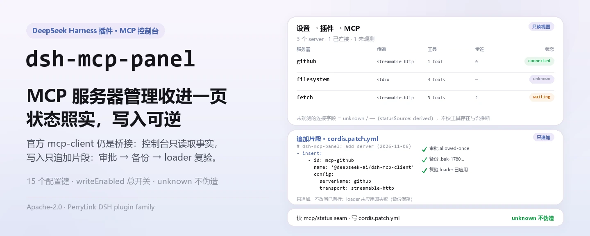
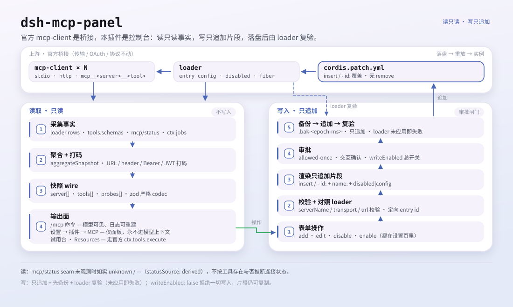

<div align="center">

<picture>
  <source media="(prefers-color-scheme: dark)" srcset="docs/assets/dsh-mcp-panel-hero-zh-dark.webp">
  
</picture>

# dsh-mcp-panel

**把 MCP 服务器的增删改和工具试用收进一个设置页——状态诚实、写入可逆。**

官方 DeepSeek Harness MCP client 的管理控制台：不用再手改 YAML，在 **设置 → 插件 → MCP** 里增删改服务器、看健康诊断、试用工具调用。

[安装](#三步上手) · [配置](#配置) · [FAQ](#faq) · [简体中文](README.md) · [English](README.en.md) · [Español](README.es.md) · [Português](README.pt.md) · [हिन्दी](README.hi.md)

[](LICENSE)
[](#兼容性)
[](https://www.npmjs.com/package/dsh-mcp-panel)
[](https://github.com/PerryLink/dsh-mcp-panel/actions/workflows/ci.yml)
[](#兼容性)

[](https://github.com/PerryLink/dsh-mcp-panel/stargazers)
[](https://www.npmjs.com/package/dsh-mcp-panel)
[](https://dshfind.com/plugins/PerryLink/dsh-mcp-panel?ref=badge)
[](https://securityscorecards.dev/viewer/?uri=github.com/PerryLink/dsh-mcp-panel)
[](https://dsh.market/)
[](https://gitee.com/perrylink/dsh-mcp-panel)

```sh
dsh plugin --profile <name> add dsh-mcp-panel
```

</div>

<sub>PerryLink 维护的官方仓库：<https://github.com/PerryLink/dsh-mcp-panel>（Gitee 为镜像）。社区插件，与 DeepSeek 官方无关。</sub>

## 它是什么

官方 MCP client 是桥接层：每个 MCP 服务器一行 `@deepseek-ai/dsh-mcp-client`，由它连接传输、同步工具、注册 `mcp__<server>__<tool>`。`dsh-mcp-panel` 是架在这层之上的控制台——通过 `mcp/status` seam、工具注册表和 loader 读取事实，把增删改操作渲染成 `cordis.patch.yml` 的片段，写入只追加、走审批、先备份、写完再复验。传输、OAuth 与协议一概不碰。

面板给的是只读运行时视图：每个 server 的 transport、目标、工具数、连接状态、最近错误与重连计数，加上健康诊断、Resources 浏览与工具试用台。控制台与手写 `cordis.yml` 的差别，只是把易错的 YAML 编辑换成了表单、预览与安全落地。

<picture>
  <source media="(prefers-color-scheme: dark)" srcset="docs/assets/dsh-mcp-panel-flow-v5-dark.svg">
  
</picture>

## 三步上手

1. **安装**（三选一）：

   ```sh
   # git 通道（最新 main；等价于 git+https://github.com/PerryLink/dsh-mcp-panel.git）
   dsh plugin --profile web add github:PerryLink/dsh-mcp-panel
   # npm 通道（已发布版本）
   dsh plugin --profile web add dsh-mcp-panel
   # tarball 通道：本仓库 pnpm pack 后
   dsh plugin --profile web add ./dsh-mcp-panel-<version>.tgz
   ```

   git 通道的 `prepare` 脚本只用生产依赖构建（`typescript` 与 `tsdown` 特意放在 `dependencies`）。

2. **重启并确认 profile 行已挂载**：

   ```sh
   dsh --profile web --dump-config | grep -A3 'id: mcp-panel'
   ```

   各配置项默认即可用；`cordis.patch.yml` 逐键内联注释，下文配置表列出全部键。

3. **打开面板或直接跑命令**：

   打开 **设置 → 插件 → MCP**，或运行：

   ```text
   /mcp
   /mcp everything tools
   /mcp everything health
   /mcp everything call echo '{"message": "hi"}'
   ```

**卸载**：从 `cordis.patch.yml` 移除 `mcp-panel` 行（web 面板热重载），从 profile 的 `node_modules` 删除本包，并用 `dsh web --dump-config` 确认没有残留的 `mcp-panel` 行。

<details>
<summary>从 DSH Desktop 市场安装</summary>

所有 PerryLink 插件均可在 DSH Desktop 内置市场中浏览：**市场 → 来源 → 添加来源 → 粘贴** `https://perrylink-dsh-catalog.perrylink.workers.dev/catalog-source.json` **→ 选中**。安装仍需通过市场的 npm 身份校验与你的确认。

</details>

## 核心能力

`dsh-mcp-panel` 是官方 MCP client 之上的体验层：只读运行时视图加上安全可逆的 profile 写入。

- **`/mcp` 命令** —— 每 server 一行：transport、目标、工具数、连接状态（来自上游 seam；未观测时如实显示 `unknown`）、最近错误、重连计数——模型可读、会话日志可重建、五种输出语言。
- **`/mcp <server> tools`** —— 模型可见的 `mcp__*` 工具名与描述。
- **`/mcp <server> health`** —— 派生自愈建议（ENOENT → 依赖缺失、ECONNREFUSED、超时、401/403/404、DNS、限流、重连耗尽…）；退出码 / stderr 尾部如实标注*待官方支持*。
- **`/mcp <server> disable` / `enable`** —— 不手改 profile patch，直接关掉或重新启用某个 server 行。
- **`/mcp <server> probe`** —— 对该 server 做一次 Streamable HTTP 连通性探测（后台任务）。
- **`/mcp <server> call <tool> [json]`** —— 经**官方工具管线**（`ctx.tools.execute()`）试用调用；pre-execute 权限策略、审批、guard、post-execute 全部生效。
- **设置 → 插件 → MCP 页** —— 状态卡片（徽章、诊断、探测），加 server CRUD 与工具试用台。
- **Server CRUD** —— 增删改表单 → 添加用 `insert`，编辑/删除用 id 定向覆盖（`- id:` + `name:` + `disabled:`/`config:`）→ 剪贴板复制或审批写入，自动备份，并在报成功前对照 loader 复验。
- **Resources 浏览** —— 经官方 `list_mcp_resources` / `list_mcp_resource_templates` / `read_mcp_resource` 工具只读列出资源、模板与 URI 读取（由上游 `@deepseek-ai/dsh-mcp-resources` 服务桥接）；结果只显示在本页、绝不进入模型上下文。
- **推荐服务器目录** —— 内置社区 MCP server 目录（filesystem、git、github、fetch、playwright…）；`catalogEntries` 可追加或覆盖条目，`catalogToConfigInput` 把一条目录项变成一键添加。
- **配置导入/导出** —— `exportConfigs()` 把 server 行序列化为带版本号的 JSON 文档（`!!js` 行导出为 `null` 并附原因），`importPreview()` 把导出的文档解析回逐 server 的 `add` 补丁片段供审阅。
- **工具试用台** —— server → `mcp__*` 工具 → JSON 参数 → 规范 JSON 结果 + render 内容；按 `trialMaxResultChars` 截断；仅面板可见、永不进入模型上下文。

### 命令与工具面

| 表面 | 类型 | 说明 |
|---|---|---|
| `/mcp` | command | 每 server 状态行；模型可读、日志可重建 |
| `/mcp <server> tools` | command | 模型可见的 `mcp__*` 工具名与描述 |
| `/mcp <server> health` | command | 由脱敏错误文本派生的自愈建议 |
| `/mcp <server> disable` / `enable` | command | 切换 profile patch 里某个 server 行 |
| `/mcp <server> probe` | command | 一次 Streamable HTTP 连通性探测（后台任务） |
| `/mcp <server> call <tool> [json]` | command | 经官方工具管线试用调用 |
| `mcp_probe` | tool | 可选 Streamable HTTP 连通性探测（后台任务） |
| 设置 → 插件 → MCP 页 | UI 槽位 | 状态卡片、server CRUD 与工具试用台 |
| `mcpPanel` Typert Remote | service | 只读快照通道（Host → client） |

### 示例

以下为插件真实入口；安装后调用一个即可。

**详细示例** —— 命令 `/mcp github tools`，输出：

```text
Tools of "github" (1, model-visible public names):
- mcp__github__create_issue — Create a new issue in a GitHub repository
```

*Observed from `plugins/dsh-mcp-panel/tests/command.spec.ts:99-110; renderer at src/command.ts:352-360`*

**失败分支** —— 输入：

```text
/mcp nope tools
```

输出：

```text
Unknown MCP server "nope" (configured: github)
```

*Observed from `plugins/dsh-mcp-panel/src/command.ts:104-105; plugins/dsh-mcp-panel/tests/command.spec.ts:152-157`*

**简短示例**：`/mcp <server> tools` · `/mcp <server> health`

## 架构：官方 client = 桥接，本插件 = 控制台

[`@deepseek-ai/dsh-mcp-client`](https://github.com/deepseek-ai/deepseek-harness/tree/master/packages/mcp/mcp-client) 是**唯一的桥接层**：每个 MCP server 一个插件实例，以手写 `cordis.yml` 行的形式配置，负责连接传输、同步工具并注册 `mcp__<server>__<tool>` 工具名。本插件从不取代它——而是构建其上的**体验层**：

```text
                    ┌────────────────────────────────────────────┐
 profile            │  cordis.yml / cordis.patch.yml             │
 组合（每个         │   - id: mcp-github                          │
  server 一行，     │     name: '@deepseek-ai/dsh-mcp-client'     │
  手写）            │     config: { serverName, transport, … }    │
                    │   - id: mcp-panel                           │
                    │     name: dsh-mcp-panel   ◄── 本插件        │
                    └───────────────┬────────────────────────────┘
                                    │
        ┌───────────────────────────┴───────────────────────────┐
        │                                                        │
   ┌────▼──────────────┐        ┌───────────────────────────┐    │
   │ @deepseek-ai/dsh- │        │ dsh-mcp-panel（控制台）    │    │
   │ mcp-client        │        │                           │    │
   │ • 传输连接        │        │ • /mcp 命令               │    │
   │ • 工具同步        │        │ • 设置 → 插件 → MCP 页：  │    │
   │ • mcp__* 工具     │◄──────►│   CRUD、工具试用台        │    │
   │ • mcp/status seam │ 状态   │ • 健康诊断                │    │
   └───────────────────┘        │ • 探测、能力一览          │    │
                                └───────────────────────────┘    │
```

控制台通过官方 client 的 `mcp/status` 可观测 seam（事件 + `mcpStatus` 查询服务；上游尚未发布，按特性探测）读取状态，并读取工具注册表与 loader；**写入**只发生在 profile 的 patch 层——只追加、走审批、自动备份。传输、OAuth 与协议完全不动。

### 控制台 vs 手写 cordis.yml

| | 手写 cordis.yml | dsh-mcp-panel 控制台 |
|---|---|---|
| 添加服务器 | 改 YAML，注意缩进与引号 | 表单 → patch 片段 → **一键复制**或**写入**（审批 + 自动备份） |
| 修改服务器 | 改 YAML，重启/热重载 | 表单预填当前行；未改动的密钥在 host 侧保留原值 |
| 删除服务器 | 删掉该行 | 追加 `- id:` + `disabled: true` 覆盖操作（patch 词汇表没有 remove）——可随时重新启用 |
| 查看状态 | 翻日志 | 徽章 + 重连次数 + 最近错误，来自 `mcp/status` seam 实时数据 |
| 试用工具 | 让模型调用 | 试用台 → 官方 `ctx.tools.execute()` 管线（权限与审批全程生效） |
| 排查故障 | grep 日志 | `/mcp <server> health` 派生自愈建议 |
| 误操作 | 手动回滚 | 每次写入只追加、留时间戳备份 |

控制台的输出就是 `cordis.patch.yml` 的词汇表——你手写的那几行，由它生成、预览并安全落地。

## 配置

所有可调项都是 Schemastery `Config` 字段（可从 cordis.yml 覆盖）。按 id 覆盖会替换整行——请重述所有需要的键。`cordis.patch.yml` 逐键内联注释。

最常用键：

| 键 | 默认值 | 含义 |
|---|---|---|
| `probeEnabled` | `true` | 注册 `mcp_probe` 后台任务工具（结果仅面板可见） |
| `probeTimeoutMs` | `10000` | 单次探测超时（ms） |
| `outputLanguage` | `en` | `/mcp` 输出语言：`en \| zh \| es \| pt \| hi` |
| `writeEnabled` | `true` | 总开关：`false` 拒绝一切 profile 写入（仍可复制片段） |
| `writeVerifyEnabled` | `true` | 每次写入在报成功前对照 loader 重放后的状态复验 |
| `backupCount` | `5` | 每次写入保留的 `cordis.patch.yml` 备份数 |

<details>
<summary>完整配置表（15 个键）</summary>

| 键 | 默认值 | 含义 |
|---|---|---|
| `probeEnabled` | `true` | 注册 `mcp_probe` 后台任务工具（结果仅面板可见） |
| `probeTimeoutMs` | `10000` | 单次探测超时（ms） |
| `maxProbes` | `10` | 面板展示的探测记录数 |
| `refreshIntervalMs` | `0` | 建议的面板刷新间隔（ms）；`0` = 按需 |
| `outputLanguage` | `en` | `/mcp` 输出语言：`en \| zh \| es \| pt \| hi` |
| `passiveProbeEnabled` | `false` | 周期性探测 streamable-http 服务器 |
| `passiveProbeIntervalMs` | `60000` | 被动探测间隔（ms） |
| `trialEnabled` | `true` | 工具试用台（设置页 + `/mcp call`） |
| `trialTimeoutMs` | `120000` | 每次试用调用的面板侧截止时间（ms） |
| `trialMaxResultChars` | `60000` | 试用结果载荷上限（字符） |
| `writeEnabled` | `true` | 总开关：`false` 拒绝一切 profile 写入（仍可复制片段） |
| `writeVerifyEnabled` | `true` | 每次写入在报成功前对照 loader 重放后的状态复验 |
| `writeVerifyTimeoutMs` | `3000` | 写入复验的轮询预算（毫秒） |
| `backupCount` | `5` | 每次写入保留的 `cordis.patch.yml` 备份数 |
| `catalogEntries` | `[]` | 推荐服务器目录的用户覆盖：追加条目，同 `id` 的条目替换内置条目 |

</details>

profile patch 覆盖示例：

```yaml
- insert:
    - id: mcp-panel
      name: dsh-mcp-panel
      config:
        probeEnabled: false
        outputLanguage: zh
        writeVerifyTimeoutMs: 5000
        backupCount: 10
```

## FAQ

<details>
<summary>面板里的连接状态是实时的吗？没观测到时显示什么？</summary>

状态来自官方 client 的 `mcp/status` seam（上游尚未发布，按特性探测）。没有上游观测的连接字段如实显示 `unknown` / `—` 并标注 `statusSource: 'derived'`；退出码与 stderr 尾部在 client 暴露前标为*待官方支持*。控制台不伪造连接状态：不可观测字段就是 `unknown` / `-1` / `—`。

</details>

<details>
<summary>控制台会改写我的 cordis.patch.yml 吗？写坏了怎么办？</summary>

不会改写。写入是只追加的生成片段，先走审批，每次保留最新 `backupCount` 份备份，并在报成功前对照 loader 重放后的状态复验；loader 没应用（例如该行由 `$DSH_HOME/cordis.patch.yml` 插入、profile 层补丁够不着）就如实报失败。`writeEnabled: false` 可一键拒绝一切写入，片段仍可复制。

</details>

<details>
<summary>面板内容会进入模型上下文吗？密钥和 header 会不会泄露？</summary>

不会。面板内容（状态卡、CRUD、试用台、Resources 浏览）只显示在设置页，永不进入模型上下文；只有 `/mcp` 命令输出对模型可读、并可由会话日志重建。渲染前会打码 URL 查询凭据、userinfo 密码、header 值、Bearer token 与 JWT；配置的 `headers` 从不进入任何快照，env/header 的**值**绝不出 Host，编辑器只见 key。

</details>

<details>
<summary>它和官方 mcp-client 是什么关系？会替换或干扰它吗？</summary>

不替换。`@deepseek-ai/dsh-mcp-client` 是唯一桥接层：每个 MCP server 一个实例、一行 `cordis.yml` / `cordis.patch.yml`，负责传输、OAuth 与协议。本插件只读它的状态 seam、工具注册表与 loader，写入只落在 profile 的 patch 层，且不注册任何提示词段落；传输、OAuth 与协议完全不动。

</details>

## 安全边界

- **桥接层仍是桥接层。** 不改传输、OAuth、协议；每个 server 一行 mcp-client，与你手写完全一致。
- **不伪造状态。** 无上游观测时连接字段显示 `unknown` / `—` 并标注 `statusSource: 'derived'`；退出码与 stderr 尾部绝不臆造。
- **写入只追加、走审批、先备份。** 控制台从不改写 `cordis.patch.yml`：只追加生成的操作，保留最新 `backupCount` 份备份，并在报成功前对照 loader 重放后的状态复验（被跳过的补丁绝不显示为成功）。
- **零提示词注入。** 本插件不注册任何提示词段落；对模型可见的文本只有两个工具/命令描述。

## 权限与数据

- **权限**：`dshWorkshop` manifest 声明 `network:outbound` 与 `native-code:none`。
- **数据**：面板只读；只写入只追加的 `cordis.patch.yml` 片段（走审批、先备份）。URL 查询凭据、userinfo 密码、header 值、Bearer token、JWT 在渲染前一律打码；配置的 `headers` 从不进入任何快照，env/header 的**值**绝不出 Host（编辑器只见 key）。

## 已知限制

- **prompt 模板与资源订阅** 待官方支持——官方 client 桥接工具与资源，但未桥接 prompts 与订阅。
- **退出码 / stderr 尾部** 在 client 暴露前如实标注*待官方支持*。
- **只读面板** —— 控制台从不伪造连接状态；不可观测字段显示 `unknown` / `-1` / `—`。
- **写入复验而非保证** —— 控制台对照 loader 重放后的状态复验每次写入；loader 未应用时（例如该行由 `$DSH_HOME/cordis.patch.yml` 插入、profile 层补丁够不着）如实报失败。

## 兼容性

| 维度 | 状态 |
|---|---|
| 宿主 | DeepSeek Harness `dsh-v0.2.1-rc.2`（2026-10-18 验证）：`engines.dsh >=0.2.1-0 <0.3.0`；P0 兼容路径已有回归测试。 |
| Node | `^22.19.0 \|\| >=24.9.0` |
| 平台 | Web GUI（双面：Host + 浏览器） |
| 模型 | 任意（面板只读；仅 `/mcp` 输出对模型可见） |

## Resources 与 Prompts

Resources 已由上游桥接：base bundle 默认挂载 `@deepseek-ai/dsh-mcp-resources`，官方 client 把每个连接的资源 provider 注册进 `ctx.mcpResources`，该包拥有三个共享工具（`list_mcp_resources`、`list_mcp_resource_templates`、`read_mcp_resource`）。控制台特征探测该服务与已注册工具，并在每个 server 卡上提供只读 Resources 浏览（列表 / 模板 / URI 读取）——每次调用都走**官方工具管线**，结果只显示在本页、绝不进入模型上下文。

MCP **prompt 模板**与**资源订阅**仍待上游；能力一览中 Prompts 标注**待官方支持**。

## 生态与质量

- [Gitee 镜像](https://gitee.com/perrylink/dsh-mcp-panel)（同步镜像，以 GitHub 为准）
- [dshfind 插件页](https://dshfind.com/plugins/PerryLink/dsh-mcp-panel)（安装量与排名）
- [OpenSSF Scorecard 报告](https://securityscorecards.dev/viewer/?uri=github.com/PerryLink/dsh-mcp-panel)（由 [.github/workflows/scorecard.yml](.github/workflows/scorecard.yml) 驱动）
- [dsh-plugin-doctor 验证报告](https://github.com/PerryLink/dsh-plugin-doctor#verified-徽章)（由 [.github/workflows/plugin-doctor.yml](.github/workflows/plugin-doctor.yml) 驱动）
- [DSH Market](https://dsh.market/)（已上架）
- **1024 商店渠道**：先 `npm i -g dsh1024`，再 `dsh1024 plugin --profile web add dsh-mcp-panel`（计入 [deepseek1024.com](https://deepseek1024.com) 安装排行）
- [生态实测知识库](https://perrylink.github.io/dsh-plugin-guide/)：插件开发指南 · 选型实测数据 · 维护取舍判据

## 开发

```sh
pnpm run typecheck && pnpm run typecheck:ci && pnpm test && pnpm run build && pnpm run verify:self-contained && pnpm run verify:artifacts && pnpm pack
pnpm run check:readmes
node scripts/verify-headless.mjs
```

`pnpm run typecheck` 解析本地 harness checkout 的新鲜类型面（tsconfig `paths`），`typecheck:ci` 解析 npm 已发布的 `0.1.7-rc.2` 类型面；两条都要绿。`scripts/verify-headless.mjs` 启动真实 web profile 并打印 `/mcp` 实际输出。发布：`node scripts/release.mjs <x.y.z>` 跑全量门禁、提交并本地打 `v<x.y.z>` 标签（绝不推送）。

配图由 [`scripts/gen-readme-assets.py`](scripts/gen-readme-assets.py) 程序化生成（Python + Pillow 画 hero、手写 SVG 画结构图）：hero 输出 `docs/assets/dsh-mcp-panel-hero-{zh,en}-{light,dark}.webp`，结构图输出 `docs/assets/dsh-mcp-panel-flow-v5-{light,dark}.svg`，可重复执行。

Topics：`dsh`, `dsh-plugin`, `deepseek-harness`, `deepseek`, `cordis`, `mcp`, `mcp-client`, `observability`, `panel`

## 家族与致谢

本项目是 [PerryLink](https://github.com/PerryLink) 维护的 DeepSeek Harness 插件家族成员（全部 Apache-2.0）。如果这个插件帮到了你，**给个 star**——它不解锁任何功能，但会让下一个人更容易找到它。

- [@PerryLink](https://github.com/PerryLink) —— 创建者与维护者。
- [@xiaoyuyu6420](https://github.com/xiaoyuyu6420) —— 诊断出干净 checkout 构建失败背后缺失的 client devDependencies（PR #5）。
- [@feiler0](https://github.com/feiler0) —— 贡献了 stdio MCP 服务器探测（通过 stdin/stdout 完成一次 MCP initialize 握手）（PR #7，以 PR #15 合并）。

<details>
<summary>展开全部插件</summary>

| 插件 | 状态 |
|---|---|
| **[dsh-aqua-input-check](https://github.com/PerryLink/dsh-aqua-input-check)** |  |
| **[dsh-archive-check](https://github.com/PerryLink/dsh-archive-check)** |  |
| **[dsh-auto-review](https://github.com/PerryLink/dsh-auto-review)** |  |
| **[dsh-autotier](https://github.com/PerryLink/dsh-autotier)** | 🧊 已冻结 — 见仓库 README |
| **[dsh-bid-ca-precheck](https://github.com/PerryLink/dsh-bid-ca-precheck)** |  |
| **[dsh-bid-qual-check](https://github.com/PerryLink/dsh-bid-qual-check)** |  |
| **[dsh-cert-mcp](https://github.com/PerryLink/dsh-cert-mcp)** | 🧊 已冻结 — 见仓库 README |
| **[dsh-checkpoint-rewind](https://github.com/PerryLink/dsh-checkpoint-rewind)** |  |
| **[dsh-click](https://github.com/PerryLink/dsh-click)** |  |
| **[dsh-composer-history](https://github.com/PerryLink/dsh-composer-history)** |  |
| **[dsh-contract-stance](https://github.com/PerryLink/dsh-contract-stance)** |  |
| **[dsh-customs-doc-check](https://github.com/PerryLink/dsh-customs-doc-check)** |  |
| **[dsh-data-quality](https://github.com/PerryLink/dsh-data-quality)** | 🧊 已冻结 — 见仓库 README |
| **[dsh-demurrage-ledger](https://github.com/PerryLink/dsh-demurrage-ledger)** |  |
| **[dsh-doublecheck](https://github.com/PerryLink/dsh-doublecheck)** |  |
| **[dsh-drill-script-check](https://github.com/PerryLink/dsh-drill-script-check)** |  |
| **[dsh-eia-guide-check](https://github.com/PerryLink/dsh-eia-guide-check)** |  |
| **[dsh-emergency-plan](https://github.com/PerryLink/dsh-emergency-plan)** |  |
| **[dsh-essay-rubric-check](https://github.com/PerryLink/dsh-essay-rubric-check)** |  |
| **[dsh-evidence-check](https://github.com/PerryLink/dsh-evidence-check)** |  |
| **[dsh-export-ctl-check](https://github.com/PerryLink/dsh-export-ctl-check)** |  |
| **[dsh-fast](https://github.com/PerryLink/dsh-fast)** |  |
| **[dsh-fmea-table-check](https://github.com/PerryLink/dsh-fmea-table-check)** |  |
| **[dsh-forecast-penalty](https://github.com/PerryLink/dsh-forecast-penalty)** |  |
| **[dsh-fund-research](https://github.com/PerryLink/dsh-fund-research)** |  |
| **[dsh-github](https://github.com/PerryLink/dsh-github)** |  |
| **[dsh-gongwen-flow-check](https://github.com/PerryLink/dsh-gongwen-flow-check)** |  |
| **[dsh-gongwen-word-check](https://github.com/PerryLink/dsh-gongwen-word-check)** |  |
| **[dsh-guard-plan-qc](https://github.com/PerryLink/dsh-guard-plan-qc)** |  |
| **[dsh-hazchem-check](https://github.com/PerryLink/dsh-hazchem-check)** |  |
| **[dsh-hazplan-check](https://github.com/PerryLink/dsh-hazplan-check)** |  |
| **[dsh-hidden-risk-map](https://github.com/PerryLink/dsh-hidden-risk-map)** |  |
| **[dsh-hs-classify](https://github.com/PerryLink/dsh-hs-classify)** |  |
| **[dsh-icd-rule-check](https://github.com/PerryLink/dsh-icd-rule-check)** |  |
| **[dsh-industry-research](https://github.com/PerryLink/dsh-industry-research)** |  |
| **[dsh-lawcite-adapter](https://github.com/PerryLink/dsh-lawcite-adapter)** |  |
| **[dsh-laya](https://github.com/PerryLink/dsh-laya)** |  |
| **[dsh-lc-doc-check](https://github.com/PerryLink/dsh-lc-doc-check)** |  |
| **[dsh-learning-gap-check](https://github.com/PerryLink/dsh-learning-gap-check)** |  |
| **[dsh-library](https://github.com/PerryLink/dsh-library)** |  |
| **[dsh-local-ai](https://github.com/PerryLink/dsh-local-ai)** |  |
| **[dsh-lsp-actions](https://github.com/PerryLink/dsh-lsp-actions)** |  |
| **[dsh-mask](https://github.com/PerryLink/dsh-mask)** |  |
| **[dsh-mcp-panel](https://github.com/PerryLink/dsh-mcp-panel)** |  |
| **[dsh-medrec-qc](https://github.com/PerryLink/dsh-medrec-qc)** |  |
| **[dsh-memento](https://github.com/PerryLink/dsh-memento)** | 🧊 已冻结 — 见仓库 README |
| **[dsh-nsfc-form-check](https://github.com/PerryLink/dsh-nsfc-form-check)** |  |
| **[dsh-nurse-record-check](https://github.com/PerryLink/dsh-nurse-record-check)** |  |
| **[dsh-observe](https://github.com/PerryLink/dsh-observe)** |  |
| **[dsh-origin-rvc-check](https://github.com/PerryLink/dsh-origin-rvc-check)** |  |
| **[dsh-ota-review-check](https://github.com/PerryLink/dsh-ota-review-check)** |  |
| **[dsh-output-styles](https://github.com/PerryLink/dsh-output-styles)** |  |
| **[dsh-paper-doc-adapter](https://github.com/PerryLink/dsh-paper-doc-adapter)** |  |
| **[dsh-permission-rules](https://github.com/PerryLink/dsh-permission-rules)** |  |
| **[dsh-permit-report-check](https://github.com/PerryLink/dsh-permit-report-check)** |  |
| **[dsh-pipeline-check](https://github.com/PerryLink/dsh-pipeline-check)** |  |
| **[dsh-pleading-draft](https://github.com/PerryLink/dsh-pleading-draft)** |  |
| **[dsh-plugin-doctor](https://github.com/PerryLink/dsh-plugin-doctor)** | 🚫 已退役（仓库已归档） |
| **[dsh-plugin-guide](https://github.com/PerryLink/dsh-plugin-guide)** |  |
| **[dsh-plugin-kit](https://github.com/PerryLink/dsh-plugin-kit)** | 🚫 已退役（仓库已归档） |
| **[dsh-plugin-upgrade](https://github.com/PerryLink/dsh-plugin-upgrade)** | 🚫 已退役（仓库已归档） |
| **[dsh-policy-brief-draft](https://github.com/PerryLink/dsh-policy-brief-draft)** |  |
| **[dsh-power-loss-split](https://github.com/PerryLink/dsh-power-loss-split)** |  |
| **[dsh-power-ticket-check](https://github.com/PerryLink/dsh-power-ticket-check)** |  |
| **[dsh-ppap-check](https://github.com/PerryLink/dsh-ppap-check)** |  |
| **[dsh-protest-deadline](https://github.com/PerryLink/dsh-protest-deadline)** |  |
| **[dsh-railway-window](https://github.com/PerryLink/dsh-railway-window)** |  |
| **[dsh-repair-order-qc](https://github.com/PerryLink/dsh-repair-order-qc)** |  |
| **[dsh-research-report](https://github.com/PerryLink/dsh-research-report)** |  |
| **[dsh-review-reply-check](https://github.com/PerryLink/dsh-review-reply-check)** |  |
| **[dsh-rulefile-check](https://github.com/PerryLink/dsh-rulefile-check)** |  |
| **[dsh-safety-brief-check](https://github.com/PerryLink/dsh-safety-brief-check)** |  |
| **[dsh-score](https://github.com/PerryLink/dsh-score)** | 🧊 已冻结 — 见仓库 README |
| **[dsh-session-sync](https://github.com/PerryLink/dsh-session-sync)** |  |
| **[dsh-site-log-check](https://github.com/PerryLink/dsh-site-log-check)** |  |
| **[dsh-skill-pack-security](https://github.com/PerryLink/dsh-skill-pack-security)** |  |
| **[dsh-soe-decision-check](https://github.com/PerryLink/dsh-soe-decision-check)** |  |
| **[dsh-soilwater-check](https://github.com/PerryLink/dsh-soilwater-check)** |  |
| **[dsh-sop-sync-check](https://github.com/PerryLink/dsh-sop-sync-check)** |  |
| **[dsh-spc-gbt-adapter](https://github.com/PerryLink/dsh-spc-gbt-adapter)** |  |
| **[dsh-talk](https://github.com/PerryLink/dsh-talk)** |  |
| **[dsh-tender-extract](https://github.com/PerryLink/dsh-tender-extract)** |  |
| **[dsh-tender-matrix](https://github.com/PerryLink/dsh-tender-matrix)** |  |
| **[dsh-test-drive](https://github.com/PerryLink/dsh-test-drive)** |  |
| **[dsh-ticktick](https://github.com/PerryLink/dsh-ticktick)** | 🚫 已退役（仓库已归档） |
| **[dsh-translate](https://github.com/PerryLink/dsh-translate)** |  |
| **[dsh-warranty-calc](https://github.com/PerryLink/dsh-warranty-calc)** |  |
| **[dsh-budget](https://github.com/PerryLink/dsh-budget)** | 🧊 已冻结 — 见仓库 README |
| **[dsh-claude-move](https://github.com/PerryLink/dsh-claude-move)** | 🧊 已冻结 — 见仓库 README |
| **[dsh-defend](https://github.com/PerryLink/dsh-defend)** | 🧊 已冻结 — 见仓库 README |
| **[dsh-draw](https://github.com/PerryLink/dsh-draw)** | 🧊 已冻结 — 见仓库 README |
| **[dsh-reach](https://github.com/PerryLink/dsh-reach)** | 🧊 已冻结 — 见仓库 README |
| **[dsh-background-agents](https://github.com/PerryLink/dsh-background-agents)** | 🚫 已退役（仓库已归档） |
| **[dsh-session-pin](https://github.com/PerryLink/dsh-session-pin)** | 🚫 已退役（仓库已归档） |
| **[dsh-team-rooms](https://github.com/PerryLink/dsh-team-rooms)** | 🚫 已退役（仓库已归档） |

</details>

## License

[LICENSE](LICENSE)（Apache License 2.0）© 2026 dsh-mcp-panel contributors

<p align="center"><sub>Apache-2.0 · 社区插件，与 DeepSeek 无关。</sub></p>
