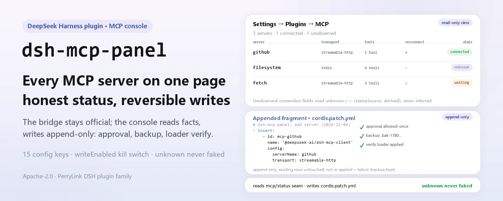
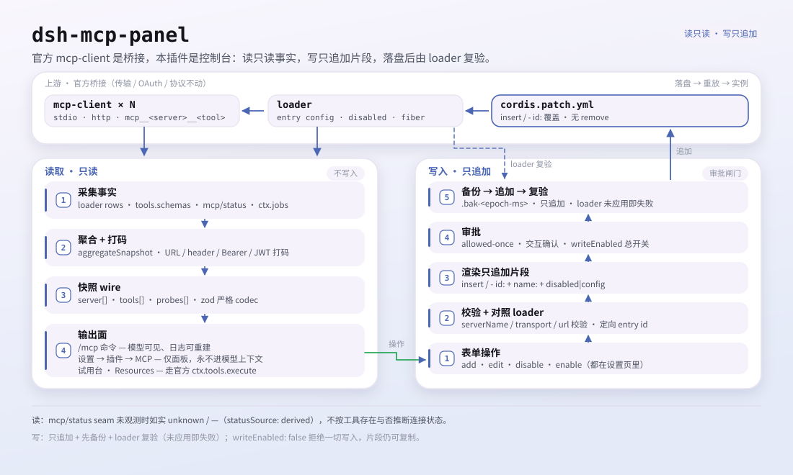

<div align="center">

<picture>
  <source media="(prefers-color-scheme: dark)" srcset="docs/assets/dsh-mcp-panel-hero-en-dark.webp">
  
</picture>

# dsh-mcp-panel

**Adicione, edite, remova e teste servidores MCP em uma única página de ajustes: status honesto e escritas reversíveis.**

O console de gestão do cliente MCP oficial do DeepSeek Harness: gerencie servidores em **Ajustes → Plugins → MCP** em vez de escrever YAML à mão.

[Instalar](#instalação-em-três-passos) · [Configuração](#configuração) · [FAQ](#faq) · [简体中文](README.md) · [English](README.en.md) · [Español](README.es.md) · [Português](README.pt.md) · [हिन्दी](README.hi.md)

[](LICENSE)
[](#compatibilidade)
[](https://www.npmjs.com/package/dsh-mcp-panel)
[](https://github.com/PerryLink/dsh-mcp-panel/actions/workflows/ci.yml)
[](#compatibilidade)

[](https://github.com/PerryLink/dsh-mcp-panel/stargazers)
[](https://www.npmjs.com/package/dsh-mcp-panel)
[](https://dshfind.com/plugins/PerryLink/dsh-mcp-panel?ref=badge)
[](https://securityscorecards.dev/viewer/?uri=github.com/PerryLink/dsh-mcp-panel)
[](https://dsh.market/)
[](https://gitee.com/perrylink/dsh-mcp-panel)

```sh
dsh plugin --profile <name> add dsh-mcp-panel
```

</div>

<sub>Repositório oficial mantido pela PerryLink: <https://github.com/PerryLink/dsh-mcp-panel> (o Gitee é um espelho). Plugin da comunidade, sem afiliação com a DeepSeek.</sub>

## O que é

O cliente MCP oficial é a ponte: uma linha de `@deepseek-ai/dsh-mcp-client` por servidor MCP, que conecta o transporte, sincroniza as ferramentas e registra os nomes `mcp__<servidor>__<ferramenta>`. `dsh-mcp-panel` é o console por cima: lê os fatos pelo seam `mcp/status`, pelo registro de ferramentas e pelo loader, renderiza as operações de adicionar/editar/remover como fragmentos de `cordis.patch.yml`, e grava apenas patches somente-anexar, com aprovação, backup e re-verificação contra o estado reaplicado pelo loader. Transporte, OAuth e protocolo permanecem intactos.

O painel é uma visão de runtime somente leitura: por servidor, transporte, destino, número de ferramentas, status de conexão, último erro e reconexões, além de diagnósticos de saúde, navegador de Resources e banco de testes de ferramentas. A única diferença para um `cordis.yml` escrito à mão é que a edição de YAML sujeita a erros vira formulários, prévias e aplicação segura.

<picture>
  <source media="(prefers-color-scheme: dark)" srcset="docs/assets/dsh-mcp-panel-flow-v5-dark.svg">
  
</picture>

## Instalação em três passos

1. **Instale** (escolha um canal):

   ```sh
   # canal git (último main; equivalente a git+https://github.com/PerryLink/dsh-mcp-panel.git)
   dsh plugin --profile web add github:PerryLink/dsh-mcp-panel
   # canal npm (versões publicadas)
   dsh plugin --profile web add dsh-mcp-panel
   # canal tarball: pnpm pack neste repo e depois
   dsh plugin --profile web add ./dsh-mcp-panel-<version>.tgz
   ```

   No canal git, o script `prepare` compila apenas com dependências de produção (`typescript` e `tsdown` são `dependencies` de propósito).

2. **Reinicie e confirme que a linha do perfil está montada**:

   ```sh
   dsh --profile web --dump-config | grep -A3 'id: mcp-panel'
   ```

   Os padrões já funcionam; `cordis.patch.yml` documenta cada chave inline e a tabela de configuração abaixo lista todas as chaves.

3. **Abra o painel ou execute um comando**:

   Abra **Ajustes → Plugins → MCP**, ou execute:

   ```text
   /mcp
   /mcp everything tools
   /mcp everything health
   /mcp everything call echo '{"message": "hi"}'
   ```

**Desinstalar**: remova a linha `mcp-panel` de `cordis.patch.yml` (a superfície web a recarrega em quente), apague o pacote do `node_modules` do perfil e verifique com `dsh web --dump-config` que não resta nenhuma linha `mcp-panel`.

<details>
<summary>Instalar a partir do mercado do DSH Desktop</summary>

Todo plugin PerryLink está listado no mercado integrado do DSH Desktop: **Market → Sources → Add source → colar** `https://perrylink-dsh-catalog.perrylink.workers.dev/catalog-source.json` **→ selecionar**. A instalação ainda exige a verificação de identidade npm do mercado e a sua confirmação.

</details>

## Capacidades principais

`dsh-mcp-panel` é a camada de experiência sobre o cliente MCP oficial: uma visão de runtime somente leitura mais escritas de perfil seguras e reversíveis.

- **Comando `/mcp`** — uma linha por servidor: transporte, destino, número de ferramentas, status de conexão (do seam upstream; `unknown` quando não observado), último erro, reconexões — legível pelo modelo, reconstruível do log de sessão, cinco idiomas de saída.
- **`/mcp <servidor> tools`** — nomes e descrições das ferramentas `mcp__*` visíveis para o modelo.
- **`/mcp <servidor> health`** — sugestões de autorrecuperação derivadas (ENOENT → dependência faltante, ECONNREFUSED, timeouts, 401/403/404, DNS, rate limit, reconexão esgotada…); código de saída / stderr rotulados honestamente como *pendente de suporte upstream*.
- **`/mcp <servidor> disable` / `enable`** — desliga ou religa uma linha de servidor sem editar o patch de perfil à mão.
- **`/mcp <servidor> probe`** — uma sonda de conectividade Streamable HTTP para esse servidor (trabalho em segundo plano).
- **`/mcp <servidor> call <tool> [json]`** — chamada de teste pelo **pipeline oficial de ferramentas** (`ctx.tools.execute()`); política de permissões pré-execução, aprovação, guards e pós-execução, tudo em vigor.
- **Ajustes → Plugins → MCP** — cartões de status com badges, diagnósticos e sondas, mais o CRUD de servidores e o banco de testes de ferramentas.
- **CRUD de servidores** — formulários de adicionar/editar/remover → `insert` para adicionar e substituições dirigidas por id (`- id:` + `name:` + `disabled:`/`config:`) para editar/remover → cópia para a área de transferência ou escrita com aprovação, backups automáticos e re-verificação contra o loader.
- **Navegação de Resources** — listagem de recursos, listagem de templates e leituras de URI somente leitura pelas ferramentas oficiais `list_mcp_resources` / `list_mcp_resource_templates` / `read_mcp_resource` (ligadas pelo serviço `@deepseek-ai/dsh-mcp-resources`); os resultados aparecem só na aba, nunca no contexto do modelo.
- **Diretório recomendado** — um catálogo comunitário embutido de servidores MCP (filesystem, git, github, fetch, playwright…); `catalogEntries` adiciona ou substitui entradas, e `catalogToConfigInput` transforma uma em inclusão com um clique.
- **Importação/exportação de configuração** — `exportConfigs()` serializa as linhas de servidores em um documento JSON versionado (uma linha `!!js` é exportada como `null` com um motivo), e `importPreview()` converte uma exportação de volta em fragmentos de patch `add` por servidor para revisão.
- **Banco de testes de ferramentas** — servidor → ferramenta `mcp__*` → argumentos JSON → resultado JSON canônico + conteúdo renderizado; limitado por `trialMaxResultChars`; só no painel, nunca no contexto do modelo.

### Superfície de comandos e ferramentas

| Superfície | Tipo | Notas |
|---|---|---|
| `/mcp` | command | Linha de status por servidor; legível pelo modelo e reconstruível do log |
| `/mcp <servidor> tools` | command | Nomes e descrições de ferramentas `mcp__*` visíveis para o modelo |
| `/mcp <servidor> health` | command | Sugestões de autorrecuperação derivadas de texto de erro saneado |
| `/mcp <servidor> disable` / `enable` | command | Alterna uma linha de servidor no patch de perfil |
| `/mcp <servidor> probe` | command | Uma sonda de conectividade Streamable HTTP (trabalho em segundo plano) |
| `/mcp <servidor> call <tool> [json]` | command | Chamada de teste pelo pipeline oficial de ferramentas |
| `mcp_probe` | tool | Sonda de conectividade Streamable HTTP opcional (trabalho em segundo plano) |
| Ajustes → Plugins → MCP | slot de UI | Cartões de status, CRUD de servidores e banco de testes |
| `mcpPanel` Typert Remote | service | Canal de snapshot somente leitura (host → client) |

### Exemplos

Estes são os pontos de entrada reais do plugin; instale uma vez e chame um.

**Exemplo detalhado** — comando `/mcp github tools`, saída:

```text
Tools of "github" (1, model-visible public names):
- mcp__github__create_issue — Create a new issue in a GitHub repository
```

*Observed from `plugins/dsh-mcp-panel/tests/command.spec.ts:99-110; renderer at src/command.ts:352-360`*

**Ramo de falha** — entrada:

```text
/mcp nope tools
```

Saída:

```text
Unknown MCP server "nope" (configured: github)
```

*Observed from `plugins/dsh-mcp-panel/src/command.ts:104-105; plugins/dsh-mcp-panel/tests/command.spec.ts:152-157`*

**Exemplos curtos**: `/mcp <servidor> tools` · `/mcp <servidor> health`

## Arquitetura: o cliente oficial = ponte, este plugin = console

[`@deepseek-ai/dsh-mcp-client`](https://github.com/deepseek-ai/deepseek-harness/tree/master/packages/mcp/mcp-client) é a **única ponte**: uma instância por servidor MCP, configurada como linha escrita à mão em `cordis.yml`, que conecta o transporte, sincroniza ferramentas e registra os nomes `mcp__<servidor>__<ferramenta>`. Este plugin nunca a substitui: é a **camada de experiência** por cima:

```text
                    ┌────────────────────────────────────────────┐
 profile            │  cordis.yml / cordis.patch.yml             │
 composition        │   - id: mcp-github                          │
 (one row per       │     name: '@deepseek-ai/dsh-mcp-client'     │
  server, hand-     │     config: { serverName, transport, … }    │
  written)          │   - id: mcp-panel                           │
                    │     name: dsh-mcp-panel   ◄── this plugin   │
                    └───────────────┬────────────────────────────┘
                                    │
        ┌───────────────────────────┴───────────────────────────┐
        │                                                        │
   ┌────▼──────────────┐        ┌───────────────────────────┐    │
   │ @deepseek-ai/dsh- │        │ dsh-mcp-panel (console)   │    │
   │ mcp-client        │        │                           │    │
   │ • transport       │        │ • /mcp command            │    │
   │ • tool sync       │        │ • Settings → Plugins →    │    │
   │ • mcp__* tools    │◄──────►│   MCP tab: CRUD, trial    │    │
   │ • mcp/status seam │ status │ • health diagnostics      │    │
   └───────────────────┘        │ • probes, capabilities    │    │
                                └───────────────────────────┘    │
```

O console **lê** o cliente pelo seu seam de observabilidade `mcp/status` (evento + serviço de consulta `mcpStatus`; ainda não publicado upstream, detectado por características), pelo registro de ferramentas e pelo loader; **grava** apenas na camada de patches do perfil — somente-anexar, com aprovação e sempre com backup. Transporte, OAuth e protocolo permanecem intactos.

### Console vs. cordis.yml escrito à mão

| | cordis.yml à mão | Console dsh-mcp-panel |
|---|---|---|
| Adicionar servidor | Editar YAML, cuidar de indentação/aspas | Formulário → fragmento de patch → **copiar** ou **gravar** (aprovação + backup) |
| Editar servidor | Editar YAML, reiniciar/recarga em quente | Formulário preenchido com a linha viva; segredos inalterados mantêm o valor bruto no host |
| Remover servidor | Apagar a linha | Substituição `- id:` + `disabled: true` (o vocabulário de patches não tem remove) — reabilitável |
| Ver status | Ler logs | Badges + reconexões + último erro, ao vivo do seam `mcp/status` |
| Testar ferramenta | Pedir ao modelo para chamar | Banco de testes → pipeline oficial `ctx.tools.execute()` (permissões e aprovação continuam valendo) |
| Diagnosticar falhas | grep nos logs | `/mcp <servidor> health` com sugestões derivadas |
| Erros | Reverter à mão | Cada escrita é somente-anexar e deixa um backup com carimbo de tempo |

A saída do console É o vocabulário de `cordis.patch.yml`: as mesmas linhas que você escreveria à mão, geradas, pré-visualizadas e aplicadas com segurança.

## Configuração

Todos os ajustes são campos Schemastery `Config` (alteráveis pelo cordis.yml). Uma substituição dirigida por id troca a linha inteira: repita todas as chaves de que precisa. `cordis.patch.yml` documenta cada chave inline.

Chaves mais usadas:

| Chave | Padrão | Significado |
|---|---|---|
| `probeEnabled` | `true` | Registra a ferramenta de trabalho em segundo plano `mcp_probe` (resultados só no painel) |
| `probeTimeoutMs` | `10000` | Timeout por sonda em ms |
| `outputLanguage` | `en` | Idioma de saída de `/mcp`: `en \| zh \| es \| pt \| hi` |
| `writeEnabled` | `true` | Chave geral: `false` rejeita toda escrita de perfil (a cópia continua funcionando) |
| `writeVerifyEnabled` | `true` | Re-verifica cada escrita contra o estado reaplicado pelo loader antes de reportar sucesso |
| `backupCount` | `5` | Backups de `cordis.patch.yml` mantidos por escrita |

<details>
<summary>Tabela de configuração completa (15 chaves)</summary>

| Chave | Padrão | Significado |
|---|---|---|
| `probeEnabled` | `true` | Registra a ferramenta de trabalho em segundo plano `mcp_probe` (resultados só no painel) |
| `probeTimeoutMs` | `10000` | Timeout por sonda em ms |
| `maxProbes` | `10` | Registros de sonda exibidos no painel |
| `refreshIntervalMs` | `0` | Atualização sugerida do painel em ms; `0` = sob demanda |
| `outputLanguage` | `en` | Idioma de saída de `/mcp`: `en \| zh \| es \| pt \| hi` |
| `passiveProbeEnabled` | `false` | Sonda periodicamente servidores streamable-http |
| `passiveProbeIntervalMs` | `60000` | Intervalo da sonda passiva em ms |
| `trialEnabled` | `true` | Banco de testes de ferramentas (aba de ajustes + `/mcp call`) |
| `trialTimeoutMs` | `120000` | Prazo do lado do painel por chamada de teste em ms |
| `trialMaxResultChars` | `60000` | Limite do payload de resultado de teste em caracteres |
| `writeEnabled` | `true` | Chave geral: `false` rejeita toda escrita de perfil (a cópia continua funcionando) |
| `writeVerifyEnabled` | `true` | Re-verifica cada escrita contra o estado reaplicado pelo loader antes de reportar sucesso |
| `writeVerifyTimeoutMs` | `3000` | Orçamento de polling para a verificação de escrita em ms |
| `backupCount` | `5` | Backups de `cordis.patch.yml` mantidos por escrita |
| `catalogEntries` | `[]` | Sobreposição do usuário no diretório recomendado: entradas são adicionadas e uma com o mesmo `id` substitui a embutida |

</details>

Exemplo de substituição no patch do seu perfil:

```yaml
- insert:
    - id: mcp-panel
      name: dsh-mcp-panel
      config:
        probeEnabled: false
        outputLanguage: zh
        writeVerifyTimeoutMs: 5000
        backupCount: 10
```

## FAQ

<details>
<summary>O status de conexão é ao vivo? O que aparece quando nada é observado?</summary>

O status vem do seam `mcp/status` do cliente oficial (ainda não publicado upstream; detectado por características). Campos de conexão sem observação upstream leem `unknown` / `—` com `statusSource: 'derived'`; códigos de saída e caudas de stderr são rotulados *pendente de suporte upstream* até o cliente expô-los. O console nunca falsifica um estado de conexão: campos não observáveis leem `unknown` / `-1` / `—`.

</details>

<details>
<summary>O console reescreve meu cordis.patch.yml? E se uma escrita der errado?</summary>

Ele nunca reescreve o arquivo. As escritas são fragmentos gerados somente-anexar, com aprovação, mantendo os `backupCount` backups mais recentes, e cada escrita é re-verificada contra o estado reaplicado pelo loader antes de reportar sucesso. Se o loader não a aplicou (por exemplo, uma linha inserida por `$DSH_HOME/cordis.patch.yml`, que um patch de camada de perfil não alcança), o console reporta a falha com honestidade. `writeEnabled: false` rejeita toda escrita e os fragmentos continuam copiáveis.

</details>

<details>
<summary>O conteúdo do painel chega ao contexto do modelo? Segredos ou headers podem vazar?</summary>

Não. O conteúdo do painel (cartões de status, CRUD, banco de testes, navegador de Resources) aparece apenas na página de ajustes e nunca entra no contexto do modelo; só a saída de `/mcp` é legível pelo modelo e reconstruível do log de sessão. Credenciais em query de URL, senhas de userinfo, valores de header, bearer tokens e JWTs são redigidos antes de renderizar; os `headers` configurados nunca entram em nenhum snapshot, e os **valores** de env/header nunca saem do host (o editor vê apenas chaves).

</details>

<details>
<summary>Qual é a relação com o mcp-client oficial? Ele o substitui ou interfere?</summary>

Não o substitui. `@deepseek-ai/dsh-mcp-client` é a única ponte: uma instância por servidor MCP, uma linha de `cordis.yml` / `cordis.patch.yml`, dona do transporte, OAuth e protocolo. Este plugin apenas lê o seam de status, o registro de ferramentas e o loader; suas escritas caem apenas na camada de patches do perfil, ele não registra seções de prompt, e transporte, OAuth e protocolo permanecem intactos.

</details>

## Limites de segurança

- **A ponte continua sendo a ponte.** Sem mudanças de transporte, OAuth ou protocolo; uma linha mcp-client por servidor, exatamente como à mão.
- **Sem status falso.** Campos de conexão sem observação upstream leem `unknown` / `—` com `statusSource: 'derived'`; códigos de saída e caudas de stderr nunca são inventados.
- **Escritas somente-anexar, com aprovação e backup.** O console nunca reescreve `cordis.patch.yml`: anexa operações geradas, mantém os `backupCount` backups mais recentes e re-verifica cada escrita contra o estado reaplicado pelo loader antes de reportar sucesso (um patch pulado nunca é lido como sucesso).
- **Sem injeção de prompt.** O painel não registra **nenhuma seção de prompt**; seu único texto visível para o modelo são as duas descrições de ferramenta/comando.

## Permissões e dados

- **Permissões**: o manifest `dshWorkshop` declara `network:outbound` e `native-code:none`.
- **Dados**: o painel é somente leitura; ele grava apenas fragmentos de `cordis.patch.yml` somente-anexar (com aprovação, backup primeiro). Credenciais em query de URL, senhas de userinfo, valores de header, bearer tokens e JWTs são redigidos antes de renderizar; os `headers` configurados nunca entram em nenhum snapshot, e os **valores** de env/header nunca saem do host (o editor vê apenas chaves).

## Limitações conhecidas

- **Templates de prompt e assinaturas de recursos** pendentes de suporte upstream: o cliente oficial liga ferramentas e recursos, mas não prompts nem assinaturas.
- **Códigos de saída / caudas de stderr** são rotulados *pendente de suporte upstream* até o cliente expô-los.
- **Painel somente leitura** — o console nunca falsifica um estado de conexão; campos não observáveis leem `unknown` / `-1` / `—`.
- **Escritas são verificadas, não garantidas** — o console re-verifica cada escrita contra o estado reaplicado pelo loader e falha com honestidade quando o loader não a aplicou (por exemplo, uma linha inserida por `$DSH_HOME/cordis.patch.yml`, que um patch de camada de perfil não alcança).

## Compatibilidade

| Superfície | Status |
|---|---|
| Harness | DeepSeek Harness `dsh-v0.2.1-rc.2` (verificado em 2026-10-18): `engines.dsh >=0.2.1-0 <0.3.0`; os caminhos de compatibilidade P0 têm testes de regressão. |
| Node | `^22.19.0 \|\| >=24.9.0` |
| Plataformas | Web GUI (face dupla: host + navegador) |
| Modelo | Qualquer (o painel é somente leitura; só a saída de `/mcp` é legível pelo modelo) |

## Resources e Prompts

Resources É ligado upstream: o bundle base monta `@deepseek-ai/dsh-mcp-resources`, o cliente oficial registra o provedor de recursos de cada conexão em `ctx.mcpResources`, e esse pacote possui as três ferramentas compartilhadas (`list_mcp_resources`, `list_mcp_resource_templates`, `read_mcp_resource`). O console detecta por características o serviço e as ferramentas registradas, e oferece um navegador de Resources somente leitura (lista / templates / leitura de URI) em cada cartão de servidor: cada chamada passa pelo pipeline OFICIAL de ferramentas e os resultados nunca entram no contexto do modelo.

Os **templates de prompt** MCP e as **assinaturas de recursos** seguem adiados upstream; o quadro de capacidades marca Prompts como **pendente de suporte upstream**.

## Ecossistema e qualidade

- [Espelho Gitee](https://gitee.com/perrylink/dsh-mcp-panel) (espelho de sincronização; o GitHub é o canônico)
- [Página do plugin no dshfind](https://dshfind.com/plugins/PerryLink/dsh-mcp-panel) (instalações e ranking)
- [Relatório OpenSSF Scorecard](https://securityscorecards.dev/viewer/?uri=github.com/PerryLink/dsh-mcp-panel) (alimentado por [.github/workflows/scorecard.yml](.github/workflows/scorecard.yml))
- [Relatório de verificação dsh-plugin-doctor](https://github.com/PerryLink/dsh-plugin-doctor#verified-徽章) (alimentado por [.github/workflows/plugin-doctor.yml](.github/workflows/plugin-doctor.yml))
- [DSH Market](https://dsh.market/) (listado)
- **Canal 1024 store**: `npm i -g dsh1024` uma vez, depois `dsh1024 plugin --profile web add dsh-mcp-panel` (conta para o ranking de instalações do [deepseek1024.com](https://deepseek1024.com))
- [Base de conhecimento do ecossistema](https://perrylink.github.io/dsh-plugin-guide/) — dados medidos, não marketing: guia de desenvolvimento de plugins · dados de seleção de plugins · critérios de manutenção

## Desenvolvimento

```sh
pnpm run typecheck && pnpm run typecheck:ci && pnpm test && pnpm run build && pnpm run verify:self-contained && pnpm run verify:artifacts && pnpm pack
pnpm run check:readmes
node scripts/verify-headless.mjs
```

`pnpm run typecheck` resolve as faces de tipos frescas do checkout local do harness pelos `paths` do tsconfig, enquanto `typecheck:ci` resolve as faces publicadas no npm `0.1.7-rc.2`; ambas devem ficar verdes. `scripts/verify-headless.mjs` sobe o perfil web real e imprime a saída exata de `/mcp`. Publicação: `node scripts/release.mjs <x.y.z>` roda o portão completo, faz commit e marca `v<x.y.z>` localmente (nunca faz push).

As imagens do README são geradas programaticamente por [`scripts/gen-readme-assets.py`](scripts/gen-readme-assets.py) (Pillow desenha o hero, o diagrama SVG é escrito à mão): o hero grava `docs/assets/dsh-mcp-panel-hero-{zh,en}-{light,dark}.webp`, a figura de estrutura grava `docs/assets/dsh-mcp-panel-flow-v5-{light,dark}.svg`, e o script pode ser reexecutado com segurança.

Topics: `dsh`, `dsh-plugin`, `deepseek-harness`, `deepseek`, `cordis`, `mcp`, `mcp-client`, `observability`, `panel`

## Família e agradecimentos

Este projeto faz parte da família de plugins do DeepSeek Harness da [PerryLink](https://github.com/PerryLink) (todos Apache-2.0). Se for útil, **uma estrela ajuda a próxima pessoa a encontrá-lo** — nada fica bloqueado por trás dela.

- [@PerryLink](https://github.com/PerryLink) — criador e mantenedor.
- [@xiaoyuyu6420](https://github.com/xiaoyuyu6420) — diagnosticou as devDependencies do cliente que faltavam por trás das falhas de build em checkout limpo (PR #5).
- [@feiler0](https://github.com/feiler0) — contribuiu a sonda de servidores MCP stdio (um handshake MCP initialize por stdin/stdout) (PR #7, mesclado como PR #15).

<details>
<summary>Expandir todos os plugins</summary>

| Plugin | Status |
|---|---|
| **[dsh-aqua-input-check](https://github.com/PerryLink/dsh-aqua-input-check)** |  |
| **[dsh-archive-check](https://github.com/PerryLink/dsh-archive-check)** |  |
| **[dsh-auto-review](https://github.com/PerryLink/dsh-auto-review)** |  |
| **[dsh-autotier](https://github.com/PerryLink/dsh-autotier)** | 🧊 CONGELADO — ver o README do repo |
| **[dsh-bid-ca-precheck](https://github.com/PerryLink/dsh-bid-ca-precheck)** |  |
| **[dsh-bid-qual-check](https://github.com/PerryLink/dsh-bid-qual-check)** |  |
| **[dsh-cert-mcp](https://github.com/PerryLink/dsh-cert-mcp)** | 🧊 CONGELADO — ver o README do repo |
| **[dsh-checkpoint-rewind](https://github.com/PerryLink/dsh-checkpoint-rewind)** |  |
| **[dsh-click](https://github.com/PerryLink/dsh-click)** |  |
| **[dsh-composer-history](https://github.com/PerryLink/dsh-composer-history)** |  |
| **[dsh-contract-stance](https://github.com/PerryLink/dsh-contract-stance)** |  |
| **[dsh-customs-doc-check](https://github.com/PerryLink/dsh-customs-doc-check)** |  |
| **[dsh-data-quality](https://github.com/PerryLink/dsh-data-quality)** | 🧊 CONGELADO — ver o README do repo |
| **[dsh-demurrage-ledger](https://github.com/PerryLink/dsh-demurrage-ledger)** |  |
| **[dsh-doublecheck](https://github.com/PerryLink/dsh-doublecheck)** |  |
| **[dsh-drill-script-check](https://github.com/PerryLink/dsh-drill-script-check)** |  |
| **[dsh-eia-guide-check](https://github.com/PerryLink/dsh-eia-guide-check)** |  |
| **[dsh-emergency-plan](https://github.com/PerryLink/dsh-emergency-plan)** |  |
| **[dsh-essay-rubric-check](https://github.com/PerryLink/dsh-essay-rubric-check)** |  |
| **[dsh-evidence-check](https://github.com/PerryLink/dsh-evidence-check)** |  |
| **[dsh-export-ctl-check](https://github.com/PerryLink/dsh-export-ctl-check)** |  |
| **[dsh-fast](https://github.com/PerryLink/dsh-fast)** |  |
| **[dsh-fmea-table-check](https://github.com/PerryLink/dsh-fmea-table-check)** |  |
| **[dsh-forecast-penalty](https://github.com/PerryLink/dsh-forecast-penalty)** |  |
| **[dsh-fund-research](https://github.com/PerryLink/dsh-fund-research)** |  |
| **[dsh-github](https://github.com/PerryLink/dsh-github)** |  |
| **[dsh-gongwen-flow-check](https://github.com/PerryLink/dsh-gongwen-flow-check)** |  |
| **[dsh-gongwen-word-check](https://github.com/PerryLink/dsh-gongwen-word-check)** |  |
| **[dsh-guard-plan-qc](https://github.com/PerryLink/dsh-guard-plan-qc)** |  |
| **[dsh-hazchem-check](https://github.com/PerryLink/dsh-hazchem-check)** |  |
| **[dsh-hazplan-check](https://github.com/PerryLink/dsh-hazplan-check)** |  |
| **[dsh-hidden-risk-map](https://github.com/PerryLink/dsh-hidden-risk-map)** |  |
| **[dsh-hs-classify](https://github.com/PerryLink/dsh-hs-classify)** |  |
| **[dsh-icd-rule-check](https://github.com/PerryLink/dsh-icd-rule-check)** |  |
| **[dsh-industry-research](https://github.com/PerryLink/dsh-industry-research)** |  |
| **[dsh-lawcite-adapter](https://github.com/PerryLink/dsh-lawcite-adapter)** |  |
| **[dsh-laya](https://github.com/PerryLink/dsh-laya)** |  |
| **[dsh-lc-doc-check](https://github.com/PerryLink/dsh-lc-doc-check)** |  |
| **[dsh-learning-gap-check](https://github.com/PerryLink/dsh-learning-gap-check)** |  |
| **[dsh-library](https://github.com/PerryLink/dsh-library)** |  |
| **[dsh-local-ai](https://github.com/PerryLink/dsh-local-ai)** |  |
| **[dsh-lsp-actions](https://github.com/PerryLink/dsh-lsp-actions)** |  |
| **[dsh-mask](https://github.com/PerryLink/dsh-mask)** |  |
| **[dsh-mcp-panel](https://github.com/PerryLink/dsh-mcp-panel)** |  |
| **[dsh-medrec-qc](https://github.com/PerryLink/dsh-medrec-qc)** |  |
| **[dsh-memento](https://github.com/PerryLink/dsh-memento)** | 🧊 CONGELADO — ver o README do repo |
| **[dsh-nsfc-form-check](https://github.com/PerryLink/dsh-nsfc-form-check)** |  |
| **[dsh-nurse-record-check](https://github.com/PerryLink/dsh-nurse-record-check)** |  |
| **[dsh-observe](https://github.com/PerryLink/dsh-observe)** |  |
| **[dsh-origin-rvc-check](https://github.com/PerryLink/dsh-origin-rvc-check)** |  |
| **[dsh-ota-review-check](https://github.com/PerryLink/dsh-ota-review-check)** |  |
| **[dsh-output-styles](https://github.com/PerryLink/dsh-output-styles)** |  |
| **[dsh-paper-doc-adapter](https://github.com/PerryLink/dsh-paper-doc-adapter)** |  |
| **[dsh-permission-rules](https://github.com/PerryLink/dsh-permission-rules)** |  |
| **[dsh-permit-report-check](https://github.com/PerryLink/dsh-permit-report-check)** |  |
| **[dsh-pipeline-check](https://github.com/PerryLink/dsh-pipeline-check)** |  |
| **[dsh-pleading-draft](https://github.com/PerryLink/dsh-pleading-draft)** |  |
| **[dsh-plugin-doctor](https://github.com/PerryLink/dsh-plugin-doctor)** | 🚫 APOSENTADO (repo arquivado) |
| **[dsh-plugin-guide](https://github.com/PerryLink/dsh-plugin-guide)** |  |
| **[dsh-plugin-kit](https://github.com/PerryLink/dsh-plugin-kit)** | 🚫 APOSENTADO (repo arquivado) |
| **[dsh-plugin-upgrade](https://github.com/PerryLink/dsh-plugin-upgrade)** | 🚫 APOSENTADO (repo arquivado) |
| **[dsh-policy-brief-draft](https://github.com/PerryLink/dsh-policy-brief-draft)** |  |
| **[dsh-power-loss-split](https://github.com/PerryLink/dsh-power-loss-split)** |  |
| **[dsh-power-ticket-check](https://github.com/PerryLink/dsh-power-ticket-check)** |  |
| **[dsh-ppap-check](https://github.com/PerryLink/dsh-ppap-check)** |  |
| **[dsh-protest-deadline](https://github.com/PerryLink/dsh-protest-deadline)** |  |
| **[dsh-railway-window](https://github.com/PerryLink/dsh-railway-window)** |  |
| **[dsh-repair-order-qc](https://github.com/PerryLink/dsh-repair-order-qc)** |  |
| **[dsh-research-report](https://github.com/PerryLink/dsh-research-report)** |  |
| **[dsh-review-reply-check](https://github.com/PerryLink/dsh-review-reply-check)** |  |
| **[dsh-rulefile-check](https://github.com/PerryLink/dsh-rulefile-check)** |  |
| **[dsh-safety-brief-check](https://github.com/PerryLink/dsh-safety-brief-check)** |  |
| **[dsh-score](https://github.com/PerryLink/dsh-score)** | 🧊 CONGELADO — ver o README do repo |
| **[dsh-session-sync](https://github.com/PerryLink/dsh-session-sync)** |  |
| **[dsh-site-log-check](https://github.com/PerryLink/dsh-site-log-check)** |  |
| **[dsh-skill-pack-security](https://github.com/PerryLink/dsh-skill-pack-security)** |  |
| **[dsh-soe-decision-check](https://github.com/PerryLink/dsh-soe-decision-check)** |  |
| **[dsh-soilwater-check](https://github.com/PerryLink/dsh-soilwater-check)** |  |
| **[dsh-sop-sync-check](https://github.com/PerryLink/dsh-sop-sync-check)** |  |
| **[dsh-spc-gbt-adapter](https://github.com/PerryLink/dsh-spc-gbt-adapter)** |  |
| **[dsh-talk](https://github.com/PerryLink/dsh-talk)** |  |
| **[dsh-tender-extract](https://github.com/PerryLink/dsh-tender-extract)** |  |
| **[dsh-tender-matrix](https://github.com/PerryLink/dsh-tender-matrix)** |  |
| **[dsh-test-drive](https://github.com/PerryLink/dsh-test-drive)** |  |
| **[dsh-ticktick](https://github.com/PerryLink/dsh-ticktick)** | 🚫 APOSENTADO (repo arquivado) |
| **[dsh-translate](https://github.com/PerryLink/dsh-translate)** |  |
| **[dsh-warranty-calc](https://github.com/PerryLink/dsh-warranty-calc)** |  |
| **[dsh-budget](https://github.com/PerryLink/dsh-budget)** | 🧊 CONGELADO — ver o README do repo |
| **[dsh-claude-move](https://github.com/PerryLink/dsh-claude-move)** | 🧊 CONGELADO — ver o README do repo |
| **[dsh-defend](https://github.com/PerryLink/dsh-defend)** | 🧊 CONGELADO — ver o README do repo |
| **[dsh-draw](https://github.com/PerryLink/dsh-draw)** | 🧊 CONGELADO — ver o README do repo |
| **[dsh-reach](https://github.com/PerryLink/dsh-reach)** | 🧊 CONGELADO — ver o README do repo |
| **[dsh-background-agents](https://github.com/PerryLink/dsh-background-agents)** | 🚫 APOSENTADO (repo arquivado) |
| **[dsh-session-pin](https://github.com/PerryLink/dsh-session-pin)** | 🚫 APOSENTADO (repo arquivado) |
| **[dsh-team-rooms](https://github.com/PerryLink/dsh-team-rooms)** | 🚫 APOSENTADO (repo arquivado) |

</details>

## Licença

[LICENSE](LICENSE) (Apache License 2.0) © 2026 dsh-mcp-panel contributors

<p align="center"><sub>Apache-2.0 · Plugin da comunidade, sem afiliação com a DeepSeek.</sub></p>
